# 架构设计（4+1 视图）

> 适用范围：`modelbench` 当前性能基准实现（bundle schema `3.0`，索引 schema `2.0`）。
> 面向维护者、评审者与 AI Agent，描述**结构、运行时行为、部署形态和演进边界**。
>
> 配套契约：[AGENTS.md](../../AGENTS.md)（硬不变量与工作流）、
> [21-test-plan.md](../spec/21-test-plan.md)（测试方案）、[20-methodology.md](../spec/20-methodology.md)（指标与缓存口径）、
> [31-output-contract.md](31-output-contract.md)（产物与二次分析）、[33-project-structure.md](33-project-structure.md)
> （自动生成目录清单）、[41-user-guide.md](../guides/41-user-guide.md)（操作）、
> [40-install.md](../guides/40-install.md)（安装）。
>
> 维护规则：本文是**文档契约**的一部分。改目录、模块、CLI、配置、产物或服务边界时，
> 必须同步本文并运行 `make docs`；与代码冲突时以代码和门禁结果为准，并回写本文。
>
> 文档状态：v1.0（2026-11-09）。4+1 视图重写；`harness.docs_contract`/`docs_links` PASS；
> 独立事实核查的 P0/P1 已闭环；剩余 P2 风险见 §8.2、§9。

---

## 0. 文档说明

### 0.1 目标与非目标

**目标**

1. 用 4+1 视图回答“系统由什么组成、如何运行、如何部署、如何扩展”。
2. 固化关键架构决策（ADR）及其代价，避免实现漂移。
3. 给关键 API 调用提供可评审的时序/流程依据（Web、oMLX、CLI、缓存、取消、落盘）。
4. 给出视图间的交叉验证与已知偏差，作为技术债和演进讨论的基线。

**非目标**（避免与专门文档重复）

| 内容 | 权威文档 |
|---|---|
| 指标公式、样本设计、缓存治理的完整论证 | [20-methodology.md](../spec/20-methodology.md) |
| 测试范围、样本预算、验收标准 | [21-test-plan.md](../spec/21-test-plan.md) |
| 安装步骤、平台支持矩阵、镜像/代理 | [40-install.md](../guides/40-install.md) |
| 结果目录使用、索引与 Excel | [31-output-contract.md](31-output-contract.md) |
| 历史方案推导 | [archive/DESIGN.md](../archive/DESIGN.md) |

### 0.2 读者与阅读路径

| 读者 | 建议阅读顺序 |
|---|---|
| 新维护者 / 评审者 | 1 → 2.3–2.6 → 3 → 4 → 8 → 9 |
| 要新增应用后端（Ollama/vLLM 等） | 1.3 → 3.5 → 2.4 → 5.5 |
| 要新增数据集/场景/测试集 | 3.5 → 5.5 → 6.3 |
| 运维 / 排障 | 6 → 4.3 → 4.5 → 4.9 → 7.2 |
| AI Agent 改代码前 | 0.5 → 3.1 → 3.7 → 4.9 → 5.4 → 5.6 |

### 0.3 视图选择与理由

本系统是一个**本地、单机、串行、证据密集型**的测量工具：它既是 CLI，也是本地 Web 控制台；
它不提供在线服务，但会驱动一个独立的 oMLX 推理服务并写大量审计文件。因此：

| 4+1 视图 | 是否采用 | 在本系统要回答的问题 | 主要图 |
|---|---|---|---|
| **场景视图（+1）** | **必须** | 用户如何发起一次测量？关键 API 按什么顺序调用？失败/取消/排队如何表现？ | 图 2-1 ~ 图 2-9 |
| **逻辑视图** | **必须** | 分层与依赖方向是什么？领域契约、端口、适配器如何组织？ | 图 3-1 ~ 图 3-3 |
| **过程视图** | **必须** | 进程/线程如何协作？为什么串行？缓存、重试、取消、资源采样如何工作？ | 图 4-1 ~ 图 4-6 |
| **开发视图** | **必须** | 代码如何组织、构建、测试？门禁和扩展点在哪里？ | §5（表/图见各小节） |
| **物理视图** | **必须** | 部署在哪？端口/认证/文件系统/安装形态是什么？安全边界在哪？ | 图 6-1 与 §6 表 |

> 4+1 中的“+1”不是附加章节：本文用场景视图**反向校验**其余四个视图是否真的支撑关键用例
> （见 §2.11、§8）。没有消费者的视图不做；本系统五个视图都有明确消费者（见 §0.2），故全部保留。
> 数据/证据模型不单列视图，由 §3.3（领域模型）、§3.8（schema 演进）、§10.1（bundle）承担。

**图目录**

| 编号 | 名称 | 所在 |
|---|---|---|
| 图 1-1 | 系统上下文 | §1.1 |
| 图 2-1 | 用例总览 | §2.1 |
| 图 2-2 | API 调用边界 | §2.2 |
| 图 2-3 | Web 发起性能测试时序 | §2.3 |
| 图 2-4 | 模型生命周期与时序 | §2.4 |
| 图 2-5 | 冷缓存逐样本测量时序 | §2.5 |
| 图 2-6 | 批量编排与结果落盘流程 | §2.6 |
| 图 2-7 | CLI 运行与预检流程 | §2.7 |
| 图 2-8 | 结果查询与二次分析 | §2.8 |
| 图 2-9 | 取消、排队与终态 | §2.9 |
| 图 3-1 | 分层与依赖方向 | §3.1 |
| 图 3-2 | 核心领域模型关系 | §3.3 |
| 图 3-3 | 端口、适配器与注册表 | §3.5 |
| 图 4-1 | 运行时进程/线程拓扑 | §4.1 |
| 图 4-2 | 一次 run 的编排状态机 | §4.2 |
| 图 4-3 | 双层锁与 job 排队时序 | §4.3 |
| 图 4-4 | 缓存治理与污染判定 | §4.4 |
| 图 4-5 | 单请求执行、重试与记录 | §4.5 |
| 图 4-6 | 取消与跳过记录 | §4.6 |
| 图 6-1 | 部署拓扑 | §6.1 |
| 图 7-1 | 可复现性与证据链 | §7.1 |

### 0.4 术语

| 术语 | 含义 |
|---|---|
| **oMLX 推理 API** | `/v1/...`：模型列表/状态、tokenize、chat completions、load/unload；API key 认证 |
| **oMLX 管理 API** | `/admin/api/...`：登录、缓存清理、模型设置、全局设置、设备信息；管理会话认证 |
| **run** | 一次“模型 × 测试集选择”的执行，产出 `output/runs/<run_id>/` 一个 bundle（`run_id` 单段） |
| **batch** | 一次用户动作触发的多模型串行执行，拆成每模型一个 run bundle，并共享 `batch_id` |
| **cell** | 聚合单元：`(model, scenario, dataset, context_length)`；默认 8 场景 × 3 档位 = 24 cells/模型 |
| **bucket / context_length** | 样本声明的上下文档位（1024/8192/32768），是 cell 维度，不跨档合并 |
| **prebuilt sample** | 预构造性能样本：prompt、tools、声明 tokens 已固化在 `perf_jsonl` 中 |
| **cold / warm / none** | 缓存治理模式：逐请求清理 / 每 cell 清一次 / 不管理（仅诊断） |
| **contaminated** | 冷模式下 `cached_tokens>0` 或缺失：保留证据但不进聚合 |
| **decode guard** | 性能模式追加的固定长输出指令，保证 TG TPS 有足够解码窗口 |
| **actual ISL** | 目标模型 `POST /v1/tokenize` 对最终 messages+tools（含 chat template 与 decode guard）的计数，用于 (a) 记录 actual/`samples.csv.isl_band` 与 (b) 窗口判定；`context_meta.isl_tolerance` 给出 target ±10% 带（所有档位对称，具体区间见 [20-methodology.md](../spec/20-methodology.md) §5 权威表）。**不因 actual 偏差跳过**；只有窗口不足/请求失败才 skip。 |
| **ISL 入带/出带** | `actual` 是否在 bucket target ±10% 带内；**只有入带 measured 样本进入 averages**，出带样本保留但不进均值；计数 `n_isl_in_band`/`n_isl_out_of_band` |
| **gen_tps_invalid** | TG TPS 被抑制的原因（枚举见 [20-methodology.md](../spec/20-methodology.md) §2）；记录保留、不进聚合 |
| **endpoint 锁** | 系统临时目录 `modelbench-locks/<sha256(normalized base_url)[:16]>.lock`，按 oMLX 实例互斥；与 output 根锁组成双锁 |
| **skipped** | 未测样本/模型的显式原因记录（`run.json.outcome.skipped`），不是静默丢弃 |

### 0.5 事实来源与文档约束

1. **代码是事实来源**：模块/类/方法名以 `src/modelbench/` 为准；本文不绑定行号，避免短期漂移。
2. **文档契约**：`harness.docs_contract` 校验 `docs/**/*.md`、`harness/prompts/*.md` 与根/README/AGENTS
   中的模块、仓库路径、`make` 目标、`./modelbench <cmd> --flag`、自动生成的结构清单，以及
   **已删除产物名黑名单**（旧环境快照/旧汇总文件/旧结果分析目录/旧扁平 run 路径/旧锁路径；
   规则定义与白名单见 [process/50-validation-plan.md](../process/50-validation-plan.md) V-7，
   `design/31-output-contract.md` 与 `archive/OUTPUT_LAYOUT.md` 的历史段被显式豁免）；`harness.gate` 的 `docs_links` 校验相对链接。
3. **数字口径**：默认性能测试集为 8 场景 × 1K/8K/32K × 10 = **240 条 measured 样本 / 24 cells**
   （每个模型）；精度测试集是隐藏离线资产（2,000 行、无 testset.yaml），runner 不读取。
4. **不静默降级**：任何跳过、失败、降级必须进入 `status`、`run.json.outcome.skipped/warnings` 或日志。
5. **单实例串行**：同一 oMLX 实例上不允许并发 benchmark；Web 进程内由 JobManager 串行，
   跨进程由**双锁**保障：`<output>/.state/benchmark.lock`（output 根，写目录互斥）+
   系统临时目录 `modelbench-locks/<sha256(normalized base_url)[:16]>.lock`（oMLX 实例互斥）。
   同一 `base_url` 的不同 `output` 根也会互斥，不同 `base_url` 可并发（见 §4.3）。

---

## 1. 架构总览

### 1.1 系统上下文

`modelbench` 是**测量编排器**：它不实现推理，只通过 HTTP 驱动本地 oMLX 服务；它把数据集的
输入、模型的实际响应和主机/服务配置固化成可复核的证据。

**图 1-1 系统上下文**

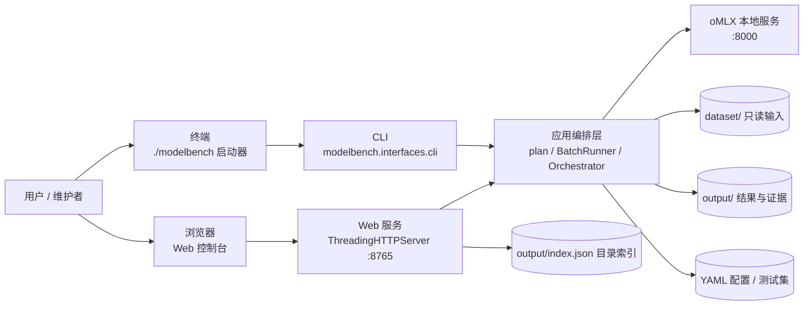

**核心外部依赖**：可达的 oMLX 服务和本地文件系统；另有可选的 `lsof`（PID 发现）、`git`（commit 记录）
与 OS 打开命令（Finder/浏览器）。没有数据库、消息队列、云服务或上传通道。
这决定了架构的形态：同步 HTTP、进程内编排、文件即证据、单机串行。

### 1.2 设计目标与架构响应

| 目标 | 架构响应 | 验证手段 |
|---|---|---|
| **测量可信** | 冷缓存 fail-closed；默认模型配置；固定抽样；decode guard；统一 `max_tokens` | 逐样本 `cache` 字段、`feature_flags`、门禁与 fake-server 用例 |
| **结果可追溯** | 每条 measured 样本一条 `SampleRecord`；环境快照；git commit；`run.json.outcome.skipped` | `records.jsonl`、`run.json`、`MANIFEST.json`、`blobs/prompts/` |
| **可复现** | `sample_id` 排序/分层抽样；配置快照；run_id；同一 oMLX/模型设置 | 重跑同一测试集与模型应得到同一样本集合 |
| **单实例安全** | Web 进程内串行锁 + 跨进程**双锁**（output 根 `.state/benchmark.lock` + oMLX endpoint 临时目录锁）；模型隔离/恢复 | 同一 `base_url`（含不同 output 根）第二个 run 快速失败；不同 `base_url` 可并发 |
| **可扩展** | `domain/` 抽象 + 注册表；`datasets/`、`scenarios/`；`AppBackend` 端口 | 新数据集/场景不改 Orchestrator；后端解耦见技术债 |
| **本地优先** | 仅回环监听；无云上传；密钥脱敏；不引入外部服务 | 默认 `127.0.0.1:8765`，非回环需显式 `--allow-external` |
| **可被 AI 持续演进** | 硬不变量 + 任务板 + 门禁 + 文档契约 + 确定性测试 | `harness.gate` 10 项默认检查（`--live` 另加 `live_smoke`）；`pytest test/` |

### 1.3 关键架构决策（ADR）

| 编号 | 状态 | 决策 | 理由 | 代价 / 边界 | 验证 / 关联 |
|---|---|---|---|---|---|
| **ADR-01** | accepted | **逐样本证据是原子单元**：每个请求写一条 `SampleRecord`，聚合只能由记录复算 | 防止“只存平均值”；支持争议样本回溯与重算 | bundle 体积大；需要 `records.jsonl` + raw 副本 | `test_core`/`test_results`；§3.3、§7.1 |
| **ADR-02** | accepted | **冷缓存 fail-closed**：清理失败中止 cell；`cached_tokens` 缺失也视为污染 | 缓存命中会把 TTFT 改变一个数量级；宁可少测不可污染 | 依赖 admin API；清理失败会导致 cell 中止 | `test_integration` 冷缓存用例；§4.4 |
| **ADR-03** | accepted（已实现） | **单实例串行（双锁）**：Web 内 `JobManager._run_lock`；跨进程同时持有 `RunLock(<output>/.state/benchmark.lock)` 与 endpoint 锁 `modelbench-locks/<sha256(normalized base_url)[:16]>.lock`（系统临时目录） | oMLX 模型隔离是全局状态；并发会互相驱逐模型；仅按 output 根加锁不足以覆盖不同 output 根共享同一实例 | 吞吐低；锁不可用拒绝启动（fail-closed） | `test_locking`/fake-server；§4.3 |
| **ADR-04** | accepted | **默认模型配置 + 仅 MoE offload**：启动前复位历史加速开关；只允许 `moe_expert_offload_enabled` | 可比较的基线必须是 oMLX 默认行为 | 需要 admin 设置接口；allowlist 随 oMLX 版本漂移 | fake-server settings 用例；§2.4 |
| **ADR-05** | accepted（目标态） | **分层 + 端口/适配器**：`interfaces → application → {domain, adapters}`，`adapters` 实现端口 | 数据集/场景扩展只改适配器；domain 可独立单测 | Orchestrator 仍直接依赖 `OMLXClient`；完整后端注入为 P1 技术债 | §3.1、§3.5、§5.5；T-004 |
| **ADR-06** | accepted | **同步客户端 + 流式读取**：`httpx` 同步 streaming，客户端 `perf_counter` 计时 | 串行测量下无需异步复杂度；计时不受服务端日志影响 | 不能测并发吞吐；超大并发场景不适用 | §2.5、§4.1 |
| **ADR-07** | accepted | **文件即接口**：run bundle（schema 3.0）+ `output/index.json` + 批次元数据文件 + 按需 Excel | 离线可审计；Web/CLI/分析工具共享同一事实源；prompt 内容寻址去重 | 需要目录约定与索引一致性维护；派生文件可重建 | `test_results`；§10.1 |
| **ADR-08** | accepted（写端点已加 Origin/Host 防护，仍无鉴权） | **本地 Web 无鉴权、仅回环** | 单机控制台，降低使用门槛 | 非回环必须显式开启且无认证；所有 POST 经 `_reject_cross_site_write` 校验 Origin/Host（跨站 403，无 Origin 的 CLI/脚本放行），但**无 token 鉴权**，仍不得暴露到不可信网络 | §6.5、§8.2；`test_web_console` |
| **ADR-09** | accepted | **文档与门禁是契约**：目录/CLI/配置/产物变化必须过 `docs_contract` | 防止 AI/人类改动造成文档漂移 | 改文档成本高；需要 `make docs-write` 维护结构清单 | §5.4；`harness.docs_contract` |

### 1.4 质量属性场景

| 质量属性 | 具体场景 | 架构响应 | 响应度量 / 验证 |
|---|---|---|---|
| **可复现性** | 同一模型、同一测试集、同一机器重跑 | 固定 `sample_id` 排序/分层；配置快照；git commit；冷缓存 | 同配置重跑 selected `sample_id` 集合一致率 100%；`summary` 可由 `records.jsonl` 复算；缺数据集内容 hash（§8.2） |
| **可审计性** | 审计某条异常 TTFT | `records.jsonl` 含请求、响应、时间戳、usage、cache 状态、模型快照 | 每个 measured 样本 1 条记录；`n_records/n_samples/n_cells` 可交叉校验 |
| **数据完整性** | 冷缓存清理失败或缓存命中 | fail-closed：中止 cell / 标记 `CONTAMINATED`；未测样本写 `skipped` | 暖缓存结果进入聚合的数量应为 0；污染/跳过记录可枚举 |
| **故障可诊断** | oMLX 内存守卫返回 507 | 不盲目重试；记录 `memory_errors` + warning；继续/中止按配置 | `memory_errors/warnings/skipped` 非空且可定位；无静默丢弃 |
| **可移植性** | macOS / Linux / Windows 工具链 | 根启动器三套；`.venv` 项目内；离线 validate；路径解析集中 | `validate --offline` 通过；启动器退出码可区分环境/配置/服务问题 |
| **安全性** | 控制台仅本机可用 | 默认回环；无密钥入库；`--allow-external` 显式风险 | 默认绑定 127.0.0.1；`secrets` 扫描 0 命中；跨站威胁见 §6.5 |
| **可维护性** | 新增场景/数据集/后端 | 注册表 + 抽象类；测试契约；门禁 | `pytest test/` 全绿、`harness.gate` PASS、`docs_contract` PASS |
| **性能隔离** | 多模型连续测试 | 串行、隔离其它模型、run 后恢复状态；双锁保证同一 oMLX 实例互斥 | 同一 `base_url`（任意 output 根）第二个 run 快速失败；不同 `base_url` 可并发 |

### 1.5 硬不变量摘要

完整清单见 [AGENTS.md](../../AGENTS.md) §2。架构上最关键的 8 条：

1. 冷缓存：measured 请求前必须清 hot+SSD，且 `cached_tokens==0`；清理失败中止 cell。
2. warmup / 污染 / 错误不参与聚合；缓存模式不混算。
3. `gen_tps/tpot` 仅在解码窗口可信时输出（`completion_tokens >= 16` 且窗口 ≥50ms、
   `finish_reason≠tool_calls`、值 ≤10,000）；被抑制时写 `metrics.gen_tps_invalid`；
   性能模式 `score` 恒为 `null`。
4. 逐样本可追溯：每个 selected 样本必须有一条 measured 记录，或一条 `run.json.outcome.skipped`。
5. 单实例串行：同一 oMLX 实例禁止并发 benchmark；跨进程由**双锁**保障
   （`<output>/.state/benchmark.lock` + `modelbench-locks/<sha256(normalized base_url)[:16]>.lock`），
   同一 `base_url` 的不同 output 根互斥，不同 `base_url` 可并发。
6. 模型默认配置：除 MoE 的 `moe_expert_offload_enabled` 外不写任何模型设置。
7. 不静默降级：跳过/失败/降级进 `status`、`run.json.outcome.skipped/warnings` 或日志。
8. 文档是契约：改 CLI/路径/配置/结构必须同步文档并通过门禁。

---

## 2. 场景视图（+1）：关键用例与 API 调用流程

### 2.1 参与者与用例总览

**用例编号规则**：图 2-1 与 §2.3–§2.9 使用同一套 UC 编号；§2.11 的追溯矩阵直接引用。
UC-08~UC-10 是支撑用例（扩展/门禁/排障），不属于单次测量主执行链。

| 编号 | 用例 | 主要参与者 | 章节 | 代码/测试证据 |
|---|---|---|---|---|
| **UC-01** | Web 发起一次性能测试 | 用户、浏览器、Web 服务、JobManager | §2.3 | `interfaces/web/{server,jobs}.py`、`test_web_console.py` |
| **UC-02** | 单模型生命周期与默认配置修复 | Orchestrator、oMLX | §2.4 | `application/benchmark.py::_ensure_model_ready`、fake-server 用例 |
| **UC-03** | 单样本冷缓存测量 | Orchestrator、CacheController、oMLX | §2.5 | `adapters/omlx/cache.py`、`test_integration.py` |
| **UC-04** | 批量编排与结果落盘 | BatchRunner、RunWriter、文件系统 | §2.6 | `application/batch.py`、`adapters/storage/`、`test_batch.py` |
| **UC-05** | CLI 发起测试与预检 | 用户、CLI、oMLX | §2.7 | `interfaces/cli.py`、`test_entrypoints.py` |
| **UC-06** | 结果查询、索引与二次分析 | 用户、浏览器、catalog、CLI | §2.8 | `interfaces/analysis/compare.py`、`test_results.py` |
| **UC-07** | 取消、排队与终态 | 用户、JobManager、文件锁 | §2.9 | `application/locking.py`、取消用例 |
| **UC-08** | 扩展数据集/场景/后端 | 维护者/AI Agent | §3.5、§5.5 | 注册表、`AppBackend` 契约 |
| **UC-09** | 运行门禁与文档契约 | 维护者/AI Agent | §5.4 | `harness/gate.py`、`harness/docs_contract.py` |
| **UC-10** | 环境快照与排障 | 运维 | §2.4、§6 | `adapters/omlx/environment.py`、`host/hardware.py` |

**图 2-1 用例总览**

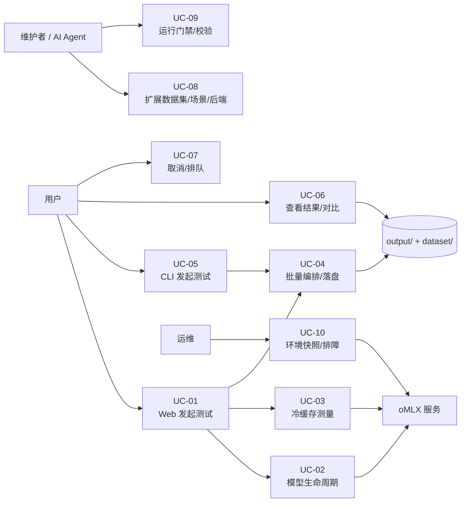

### 2.2 API 调用边界总览

系统有四类调用边界。与 oMLX 的跨进程调用都经过 `httpx`；另有少量 `lsof`/`git`/子进程/OS 打开操作。Web 前端只调用本系统 Web API。

| 边界 | 协议 | 认证 | 主要代码 |
|---|---|---|---|
| 浏览器 → Web 服务 | HTTP/JSON（回环） | 无（仅本机） | `interfaces/web/server.py`、`jobs.py` |
| Web 服务 → oMLX | HTTP/JSON + SSE | 推理 API key / admin 会话 | `adapters/omlx/{client,backend}.py` |
| CLI → oMLX | HTTP/JSON + SSE | 同上 | `interfaces/cli.py` → `BatchRunner` |
| CLI/Web → 文件系统 | 文件读写 | 操作系统权限 | `adapters/storage/`、`host/` |

**图 2-2 API 调用边界**

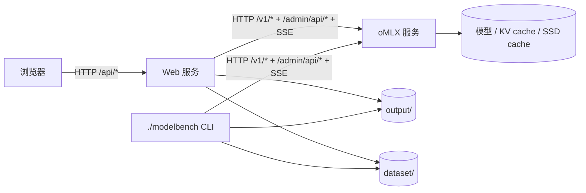

### 2.3 UC-01：Web 发起一次性能测试（端到端）

**入口**：`POST /api/run`；**结果**：202 + `job_id`，后台串行执行；浏览器轮询进度。

**图 2-3 Web 发起性能测试时序**

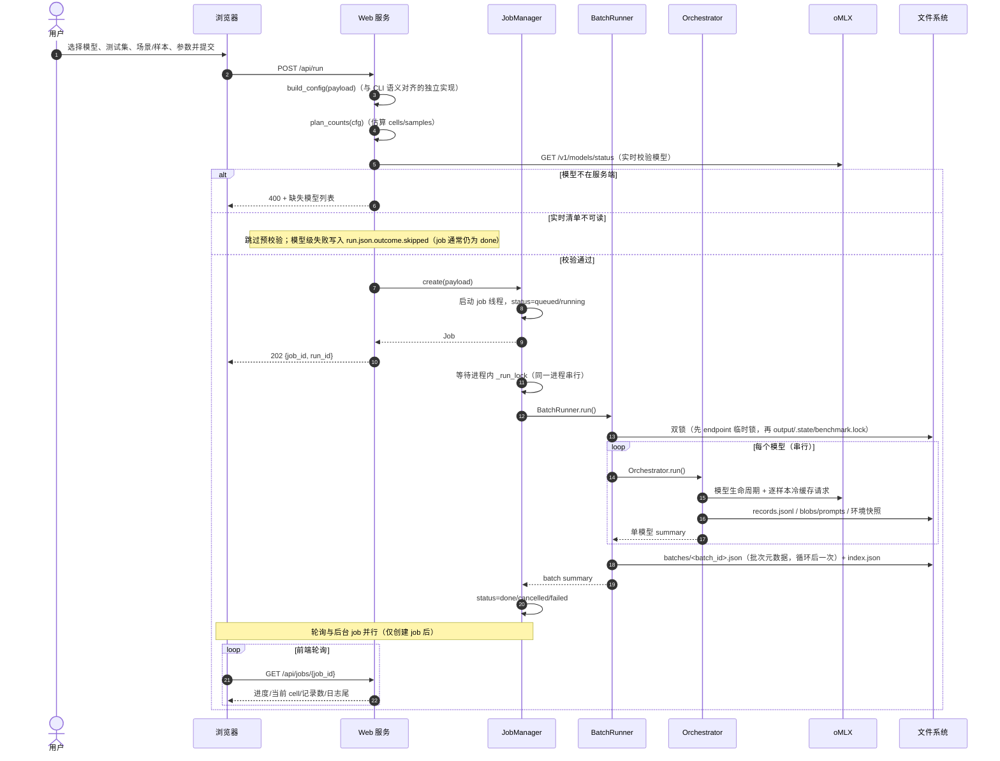

**关键步骤与不变量**

1. **配置解析与 CLI 语义对齐**：Web 的 `build_config(payload)` 是独立实现（不是 import CLI 的函数），
   把 Web 请求映射为 `ProjectConfig`（测试集 overlay、模型/场景、样本、上下文窗口、`max_tokens`、
   repeats、缓存/思考模式、上限），并强制 `isolate_models/restore_state=true`。
2. **计划先行**：`plan_counts(cfg)` 使用 `DatasetAdapter.plan()`；首次调用会流式建立轻量索引并缓存
   （按 mtime/size 失效），之后估算不重扫全量 JSONL，得到
   `models_total`/`scenarios_total`/`cells_total`/`samples_total`，用于进度百分比。
3. **模型预校验**：实时清单（`GET /v1/models/status`）可读时，缺失模型直接 400，避免 404 空 run；
   清单不可读时**不把错误当成“模型缺失”**，跳过预校验，由 run 中的模型级失败写 `run.json.outcome.skipped`。
4. **串行**：Web 进程内 `JobManager._run_lock`；跨进程持有**双锁**，按序先取 oMLX endpoint 锁
   `modelbench-locks/<sha256(normalized base_url)[:16]>.lock`（系统临时目录），再取 output 根
   `.state/benchmark.lock`（与 `application/locking.py` 及 AGENTS #10 的获取顺序一致）。
   同一 `base_url` 的不同 output 根互斥；不同 `base_url` 可并发；占用时快速失败并提示锁路径/PID。
5. **进度语义**：`record` 事件只累计非 warmup 记录；`cell_start` 记录当前 cell 的
   `samples × repeats`，`percent` 优先按 `samples_total`，否则按 cells 估算。
6. **终态**：`done`、`cancelled`、`failed`；失败信息进 `job.error`，不影响已完成模型的 bundle。

**主要失败路径**

| 触发 | HTTP/状态 | 行为 |
|---|---|---|
| 请求体非法 / 未选模型 / 未知测试集 | 400 | `build_config` 抛 `ValueError`，不创建 job |
| 选定模型不在 oMLX | 400 | 返回中文提示，要求刷新/同步模型清单 |
| 另一个进程持有同 output 根或同 oMLX endpoint 的锁 | job `failed` | `RunLockError` 快速失败，提示锁文件与持有者 PID（双锁任一占用即拒绝） |
| 两个进程用不同 output 根、同一 `base_url` | 快速失败 | endpoint 锁互斥（同一 oMLX 实例不可并发）；不同 `base_url` 才可并发 |
| oMLX 不可达 | job 通常 `done`（`fail_fast=true` 时 `failed`） | `OMLXError` 被转成模型级 `run.json.outcome.skipped`，job 仍正常收尾 |
| 用户取消 | `cancelling` → `cancelled` | 协作取消；未测样本写 `run.json.outcome.skipped`；finally 清理 |

### 2.4 UC-02：单模型生命周期与默认配置修复（ADR-04）

这是测量可信度的前置条件：**先让模型处于“默认配置 + 已加载 + 环境已快照”的状态，再测**。

**图 2-4 模型生命周期与默认配置修复时序**

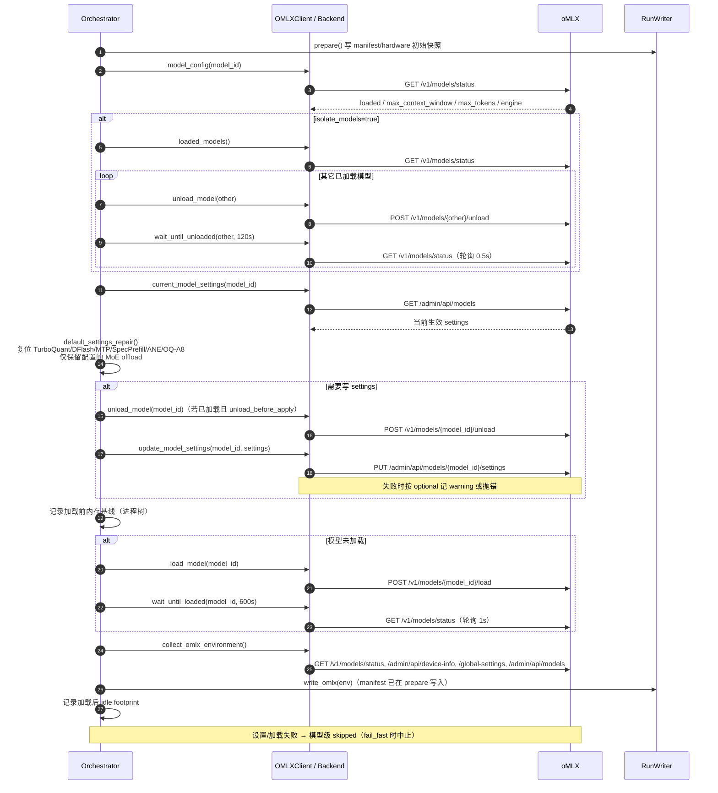

**规则**

1. **只允许一个设置项**：`ModelLoadConfig.settings` 在配置校验阶段只接受
   `moe_expert_offload_enabled`；其它加速开关一律拒绝。
2. **历史遗留必须复位**：`default_settings_repair()` 扫描当前 settings，把仍为 `True` 的
   非默认加速开关复位为 `False`（完整清单见 [21-test-plan.md](../spec/21-test-plan.md) §2），再应用显式 MoE 配置。
3. **engine 级参数需要重载**：写 settings 前若模型已加载，先 unload 并等待卸载，保证新参数生效。
4. **optional 语义**：`load.optional=true` 时设置失败降级为 warning；`false` 时中止该模型。
5. **加载等待**：`wait_until_loaded` 轮询 `/v1/models/status`，Orchestrator 显式传 600s
   （client 方法默认 300s）；超时记 warning 但继续（后续请求会暴露真实失败）。
6. **恢复状态**：`run.restore_state=true` 时，run 结束只卸载“本次加载过”的模型；缓存清理在
   `finally` 中无条件执行（不受 `restore_state` 控制）。oMLX 已因内存压力驱逐的模型不重复卸载。
7. **环境快照**：硬件、oMLX 版本、全局设置（密钥脱敏）、**服务端全量模型状态**
   （`env.server_models`，原独立模型清单文件并入）、每模型生效 settings 白名单投影、加速
   feature flags、模型内存基线/加载增量，写入 `run.json` 的 `env`（硬件/oMLX/`server_models`/
   `model_env` 唯一环境快照；`model_env` 按内容哈希索引）。

**失败与降级**

| 场景 | 行为 |
|---|---|
| admin API 登录失败 | 缓存清理无法保证 → 冷模式中止 cell（fail-closed） |
| settings 应用失败且 optional | 记 `warnings`，继续测量（结果需人工判断是否可信） |
| 模型加载超时 | warning + 继续；请求失败按样本记录 |
| 其它模型卸载失败 | warning；隔离不完整时结果可能受干扰，需人工复核 |
| 内存守卫拒绝（507） | 记录 `memory_errors`，不盲目重试，继续或按 `fail_fast` 中止 |

### 2.5 UC-03：单样本冷缓存测量（核心 API 调用）

**目标**：在“缓存已清空、模型已就绪”的条件下，发一次流式 chat 请求，采集客户端时间戳、
服务端 usage、进程树资源峰值，形成一条可审计记录。

**图 2-5 冷缓存逐样本测量时序**

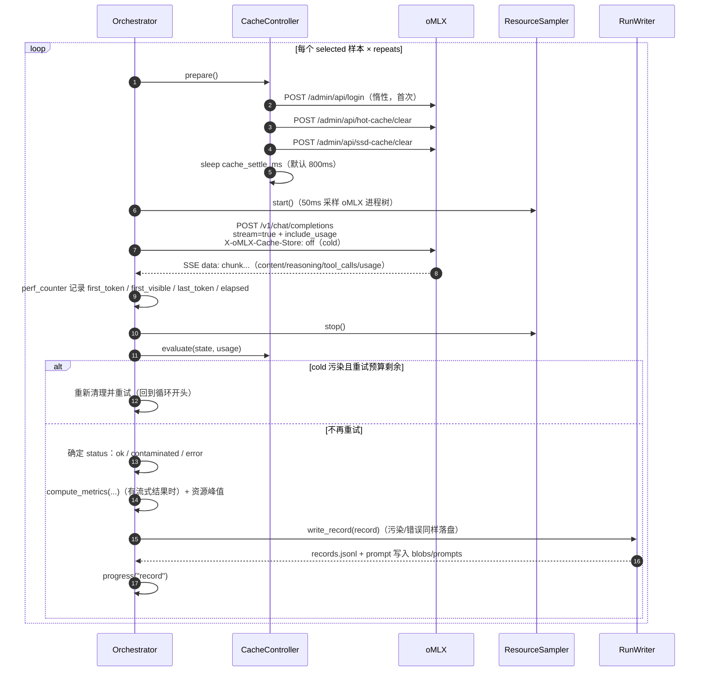

> 终止分支：清理失败 → 中止 cell；污染重试耗尽 → `contaminated` 记录；错误/超时 → `error`
> 记录；均见 §2.12、§4.4–§4.5。

**测量协议要点**

1. **清理顺序**：hot cache → SSD cache → 等待 `cache_settle_ms`；两步都必须成功才视为
   `cleared_before_request=true`。**缓存清理发生在目标模型 tokenize 之后**（tokenize 属于
   测量窗口外的口径判定步骤），因此 tokenize 的缓存/预热影响不会带入测量；cold 模式下
   measured 请求的 TTFT/TPS/内存窗口从清缓存后开始，`tokenize_latency_ms` 只做开销审计。
2. **请求头**：cold 模式 `X-oMLX-Cache-Store: off`，避免 benchmark prompt 反过来填充缓存；
   warm 模式允许缓存复用（每 cell 只清一次）。
3. **时间戳**：客户端 `time.perf_counter()`；`first_token` 包含 reasoning 的第一个 token，
   `first_visible` 是第一个可见 content；usage-only/finish chunk 不延长解码窗口。
4. **污染判定**：冷模式下 `cached_tokens>0` → `polluted`；字段缺失 → **同样视为污染**
   （无法证明是冷请求）。污染记录保留在 `records.jsonl`，但不进聚合。
5. **decode guard**：在请求末尾追加固定长输出指令（`perf.decode_guard=true` 默认开启），
   原文写入 `record.request` 和 `context_meta`；它只保证解码窗口，不改变档位声明。
   token 增量分组件（数字见 [20-methodology.md](../spec/20-methodology.md) §2）：guard 与 chat template 增量，
   合计 `input_context_tokens` 比声明多约 +46–69。
6. **实际输入大小与窗口判定**：请求前（**测量窗口之外**）用目标模型 `POST /v1/tokenize`
   对最终 messages+tools（含 chat template 与 decode guard）计数，写
   `request.tokenized_prompt_tokens`、`context_meta.tokenize_latency_ms` 与
   `context_meta.isl_tolerance{target,low,high,actual,ok}` 与
   `context_meta.window_check_basis`（tokenized|declared）。**actual 不驱动跳过**：所有能测
   样本都 measured；actual 只用于 (a) `samples.csv.isl_band` 与入带/出带计数、
   (b) 窗口判定（target ±10%，所有档位对称，区间见 [20-methodology.md](../spec/20-methodology.md) §5；
   只对入带样本求平均）。
   窗口判定用该实际值 + `max_tokens` + `context_safety_margin(128)`；超窗进
   `outcome.skipped`，tokenize 失败回退声明值+242（`window_check_basis=declared`）并 warning。
   容差之所以是 ±10%（所有档位对称）而非构造期的 ±5%（完整推导见
   [11-performance-testset.md](../spec/11-performance-testset.md) §4.5 单一事实源）：**不跳过**，
   而是只对入带样本求平均、出带保留，避免把"不同工作量"混进同一 cell 平均值，
   同时保留同一套样本的可比性。
7. **资源采样**：`ResourceSampler` 每 `run.cpu_sample_interval_ms`（默认 50ms）采样 oMLX
   进程树的 CPU/RSS/`phys_footprint`；macOS 用 `phys_footprint`（含 Metal），其它平台回落 RSS。
8. **落盘**：`records.jsonl` 每行一条完整记录；prompt 正文按内容寻址写入 `output/blobs/prompts/`，
   记录只保留 `request.prompt_sha256`/`prompt_chars`；记录包含 `cache`、`metrics`（含
   `gen_tps_invalid`/`decode_window_ms`）、`context_meta.tokenize_latency_ms`、`sample_meta`
   与指向 `run.json.env.model_env` 的 `model_env_ref`。

**缓存模式对照**

| 模式 | 清理时机 | 允许缓存命中 | 用途 |
|---|---|---|---|
| `cold`（默认） | 每次 measured 请求前 | 否；命中即污染 | 对外主结果 |
| `warm` | 每个 cell 首次请求前 | 是；测稳态复用 | 缓存/预热对比，单列 |
| `none` | 不清理 | 不管理 | 仅诊断，不与 cold/warm 混算 |

### 2.6 UC-04：批量编排与结果落盘

一次用户动作 = 一个 batch（`batches/<batch_id>.json` 一份元数据 + 每模型一个 run 目录）；
batch 内**逐模型串行**，每个模型一个独立 run bundle。

**图 2-6 批量编排与结果落盘流程**

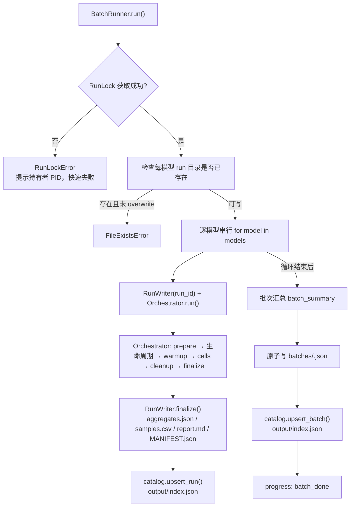

> 本图只画成功主路径；单模型异常、取消、`max_requests` 截断见 §2.12。Excel 不再由批次自动生成，
> 需要时用 `./modelbench export-analysis` 按需写到 `output/exports/<batch_id>.xlsx`，
> 目录与文件规范见 [31-output-contract.md](31-output-contract.md) §8。

**批次与 bundle 约定**

1. `run_id = <batch_id>__<method>__<model_slug>`（单段，不含 `/`），**同时是 `runs/` 下的
   目录名**（布局为 `runs/<run_id>/` 一层平铺）；`method` 当前为 `performance`。批次元数据在
   `batches/<batch_id>.json`，用 `model_runs[].run_id`/`run_path` 声明成员。跨进程由双锁保证
   同一 oMLX 实例串行（output 根锁 + endpoint 锁，见 §4.3）。
2. 每个模型 bundle 是标准 schema 3.0 run，可独立分析；`batch_id` 只做分组，不混合原始记录。
3. `max_requests` 在 batch 内按模型扣减；剩余额度为 0 时，剩余模型写 `skipped`。
4. 单模型失败默认不终止其它模型（除非 `run.fail_fast=true`）；失败原因进 `skipped/warnings`。
5. `batches/<batch_id>.json` 是批次元数据的唯一权威副本；`output/index.json` 是只读消费者
   的稳定入口。
6. Excel 是按需派生物（`output/exports/`），不参与批次写盘，也不影响证据完整性。

### 2.7 UC-05：CLI 运行与预检

CLI 与 Web 共用 `BatchRunner` 和 `Orchestrator`，区别只在配置来源与交互方式。

**图 2-7 CLI 运行与预检流程**

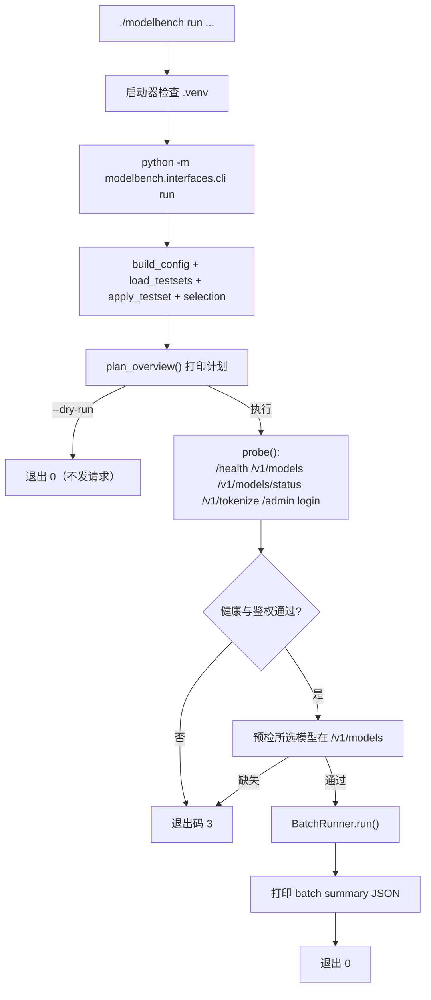

> 失败分支：`Ctrl+C` → 130；文件锁被占 → 1；oMLX 不可达/鉴权失败/模型缺失 → 3（§2.12）。

**退出码语义**

| 退出码 | 含义 |
|---|---|
| `0` | 成功，或 `--dry-run` 仅打印计划 |
| `1` | run 执行失败（未捕获异常） |
| `2` | 缺少 oMLX API key；也可能是根启动器发现 `.venv` 未就绪（两者不同源） |
| `3` | oMLX 不可达 / API key 被拒 / 所选模型不在服务端 |
| `130` | 用户 `Ctrl+C` 中断 |

**预检的重要性**：`models.yaml` 可能落后于 oMLX 实际模型；CLI 在开跑前用 `/v1/models` 校验，
避免多模型 run 中途 404。Web 在 `POST /api/run` 用 `GET /v1/models/status` 做存在性预校验（与 CLI 的 `/v1/models` 不同源）。

### 2.8 UC-06：结果查询、索引与二次分析

**图 2-8 结果查询与二次分析时序**

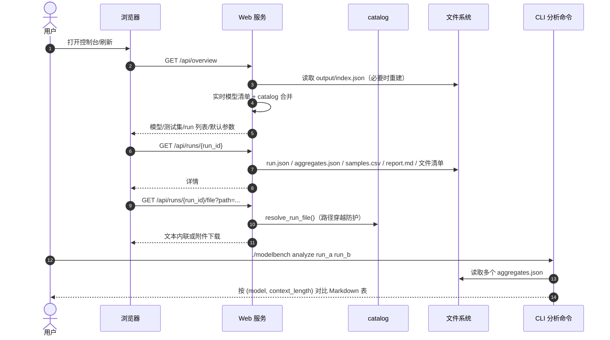

**读取安全**：`/api/runs/<id>/file` 只允许 run 目录内文件；`resolve_run_file` 做路径规范化与
越界拒绝；`>2MB` 或 `download=1` 走附件下载，文本类内联并加 `nosniff`。
**对比口径**：`interfaces/analysis/compare.py` 按 `(model, context_length)` 对齐 `aggregates.json`
的 `overall`，不跨档位合并；目标可以是 run 目录、`aggregates.json` 路径或单段 `run_id`。
逐样本不再随详情返回，改由 `/api/runs/<run_id>/samples?offset=&limit=` 分页读 `samples.csv`。

### 2.9 UC-07：取消、排队与终态

**图 2-9 取消、排队与终态**

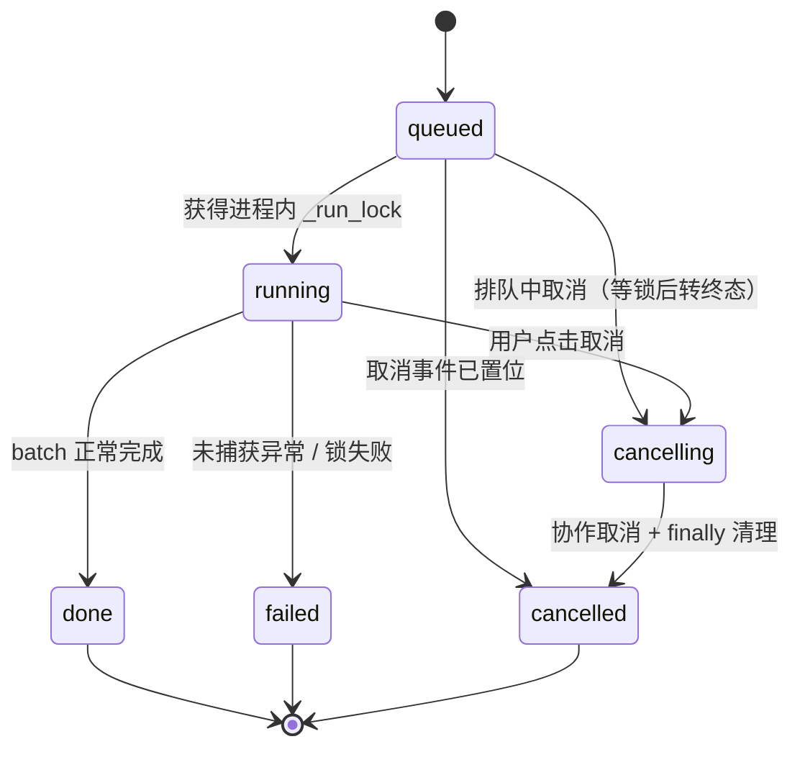

**协作取消点**：模型循环开始、场景准备、cell 开始、样本开始、每个 repeat 前。取消不是强杀进程：
`threading.Event` 置位，`Orchestrator._check_cancel()` 在边界抛 `RunCancelled`。

**取消后的证据完整性**

1. 当前 cell 未测完的样本 → 逐条 `run.json.outcome.skipped`（含 scenario/label/sample/repeat/reason）。
2. 尚未开始的 cell/场景 → 场景级或样本级 `skipped`。
3. 尚未开始的模型 → batch 级 `skipped`。
4. `finally` 仍执行：缓存清理、`restore_state` 卸载、`writer.close()`；正常/取消路径随后执行
   `finalize()` 写 summary/CSV/report/索引。未捕获异常会跳过 finalize（bundle 无 summary，由 batch 记失败）。
5. 已完成的模型 bundle 保留且有效；job 终态 `cancelled`。

### 2.10 API 端点清单

#### 2.10.1 oMLX 推理与健康 API（`/v1` + `/health`，API key）

| 方法 | 路径 | 用途 | 调用方 |
|---|---|---|---|
| GET | `/health` | 健康检查 | `probe()`、`prepare()` |
| GET | `/v1/models` | 模型列表 | CLI 预检 |
| GET | `/v1/models/status` | 模型加载状态/上下文/engine | 生命周期、隔离、等待、环境快照、Web 实时清单 |
| POST | `/v1/tokenize` | 精确 prompt token 计数 | 请求构建、上下文窗口筛选 |
| POST | `/v1/chat/completions` | 流式推理（SSE） | `_execute()`、warmup |
| POST | `/v1/models/{id}/load` | 加载模型 | `_ensure_model_ready` |
| POST | `/v1/models/{id}/unload` | 卸载模型 | 隔离、settings 前、`restore_state` |

认证：`Authorization: Bearer <key>` + `X-API-Key: <key>`；key 来自
`server.api_key`、环境变量或 oMLX 本地设置（`api_key_from_omlx_settings`）。

#### 2.10.2 oMLX 管理 API（`/admin/api`，admin 会话）

| 方法 | 路径 | 用途 | 副作用 |
|---|---|---|---|
| POST | `/admin/api/login` | 用 admin key 换会话 cookie（未单独配置时回退主 API key） | 无（建立会话） |
| POST | `/admin/api/hot-cache/clear` | 清热缓存 | 有：影响后续请求 TTFT |
| POST | `/admin/api/ssd-cache/clear` | 清 SSD 缓存 | 有：影响后续请求 TTFT |
| GET | `/admin/api/models` | 模型目录 + 生效 settings | 无 |
| PUT | `/admin/api/models/{id}/settings` | 写入模型设置 | **有：改变模型配置** |
| GET | `/admin/api/global-settings` | 全局设置快照（脱敏） | 无 |
| GET | `/admin/api/device-info` | 芯片/内存/GPU 等 | 无 |

#### 2.10.3 Web 控制台 API（回环，无鉴权）

| 方法 | 路径 | 用途 | 关键语义 |
|---|---|---|---|
| GET | `/api/overview` | 首页聚合 | 实时模型 + 测试集 + run 列表 + 默认参数 |
| GET | `/api/models` | 模型清单 | 服务端不可达时返回 `error`，不把模型判缺失 |
| POST | `/api/models/sync` | 预览/写回 `models.yaml` | `apply=false` 预览；`apply=true` 文本级原子写；运行中 409 |
| GET | `/api/testsets/<ts>/scenarios/<sc>/samples` | 样本浏览 | 分页；大数据集用子进程解析 |
| POST | `/api/estimate` | 计划估算 | 不入队；返回 cells_total/samples_total 等（无独立 requests 字段） |
| POST | `/api/run` | 发起 run | 202；模型预校验；JobManager |
| GET | `/api/jobs` | 任务列表 | 同进程页面刷新可恢复；进程重启后 job 历史丢失（内存态，见 §4.10） |
| GET | `/api/jobs/<id>` | 任务详情 | 进度 + 日志尾 |
| POST | `/api/jobs/<id>/cancel` | 协作取消 | 409 表示不可取消 |
| GET | `/api/runs` | run 列表 | `index.json` |
| GET | `/api/runs/<id>` | run 详情 | summary/manifest/omlx/report/文件 |
| GET | `/api/runs/<id>/file?path=` | 读 run 文件 | 路径穿越防护；大文件下载 |
| POST | `/api/runs/<id>/reveal` | Finder 打开 run | 本机 UI 副作用 |
| POST | `/api/output/reveal` | 打开 output | 本机 UI 副作用 |
| POST | `/api/testsets/reveal` | 打开测试集目录 | 本机 UI 副作用 |
| GET | `/api/index` | 读取索引 | catalog |
| POST | `/api/index/rebuild` | 重建索引 | 写 `output/index.json` |
| GET | `/api/health` | 存活探针 | `{ok:true}` |

**写端点统一前置校验**：所有 `POST` 在 `do_POST` 最前面执行 `_reject_cross_site_write`——
请求带 `Origin` 时要求 `http|https` 且 netloc 与 `Host` 完全一致（含端口），否则 **403**；
不带 `Origin` 的 curl/CLI/脚本按设计放行。详见 §6.5；这不是鉴权，`--allow-external` 仍是危险开关。

### 2.11 场景视图对其他视图的验证

> 本表是 4+1 的“+1 校验”：每个 UC 必须在其余视图找到**可执行证据**；结论列区分
> “一致 / 部分一致 / 已知缺口”，反证列说明承诺不成立时会在哪里暴露。

| UC | 逻辑视图证据 | 过程视图证据 | 开发/物理证据 | 结论与反证 |
|---|---|---|---|---|
| UC-01 Web run | `interfaces/web` 只做协议/校验；`build_config/plan_counts` 在 Web 层，执行在 application | job 线程 + 双锁；`/v1/models/status` 预检 | 回环 Web + 独立 oMLX；`test_web_console.py` | 一致 |
| UC-02 模型生命周期 | `AppBackend` 目标态；实际 Orchestrator 依赖 `OMLXClient` | 隔离→设置→加载→快照顺序固定 | fake-server 用例；admin 权限 | **部分一致**：端口缺 `models_status/loaded_models/model_config/discover_server_pid`（§3.5、T-004） |
| UC-03 冷缓存测量 | `CacheState/PerfMetrics/SampleRecord` 可表达 | fail-closed + 独立污染预算 | `test_integration.py` 覆盖 | 一致 |
| UC-04 批量落盘 | `BatchRunner`/`RunWriter`/`catalog` 分离 | 每模型串行、单模型失败隔离；批次/Excel 在循环后 | `test_batch.py`/`test_results.py` | 一致 |
| UC-05 CLI | 与 Web 语义对齐，但 `build_config` 是两份独立实现 | 主线程同步 + 同 output 根文件锁 | 三套根启动器；`test_entrypoints.py` | 一致；配置装配重复是维护风险（P2） |
| UC-06 结果查询 | `catalog/compare` 只读索引与 aggregates | 不重扫 JSONL；索引写失败会使模型失败 | 文件即接口；`test_results.py` | 部分一致：索引重建失败未降级（§4.3） |
| UC-07 取消 | 取消事件是应用层协议 | 边界检查 + finally → finalize | 进程不被强杀；双锁覆盖 output 根与 endpoint | 一致 |

### 2.12 失败、取消与重试终止分支

| UC | 终止分支 | 行为 | 证据字段 |
|---|---|---|---|
| UC-02 | settings 失败（`optional=false`）/ load 失败 | 模型级 `skipped`；`fail_fast=true` 时向上抛 | `run.json.outcome.skipped` |
| UC-02 | 加载超时 | warning，继续；请求失败按样本记录 | `warnings`、`status` |
| UC-03 | 缓存清理失败 | 中止 cell，剩余样本 `skipped` | `CacheState.note`、`skipped` |
| UC-03 | 污染重试耗尽 | 写 `contaminated` 记录，不进聚合 | `status` |
| UC-03 | 请求错误/超时 | 写 `error`/`timeout` 记录 | `records.jsonl` |
| UC-04 | 单模型异常 | `skipped/warnings`，继续下一模型（除 `fail_fast`） | `batch_summary` |
| UC-04 | 用户取消 | 剩余模型/样本 `skipped`，job `cancelled` | `run.json.outcome.cancelled` |
| UC-04 | `max_requests` 截断 | 剩余样本/模型 `skipped` | `run.json.outcome.skipped` |
| UC-04 | 索引刷新失败 | 不使 batch 失败（索引可重建），警告进 `warnings` | `batches/<batch_id>.json` 的 `warnings` |
| UC-05 | `Ctrl+C` | CLI 退出码 `130` | CLI |
| UC-05 | 文件锁被占 | CLI 退出码 `1` / Web job `failed` | `RunLockError` |
| UC-07 | 排队中取消 | `queued → cancelling → cancelled` | job `status` |

---

## 3. 逻辑视图

### 3.1 分层与依赖方向

**图 3-1 分层与依赖方向**

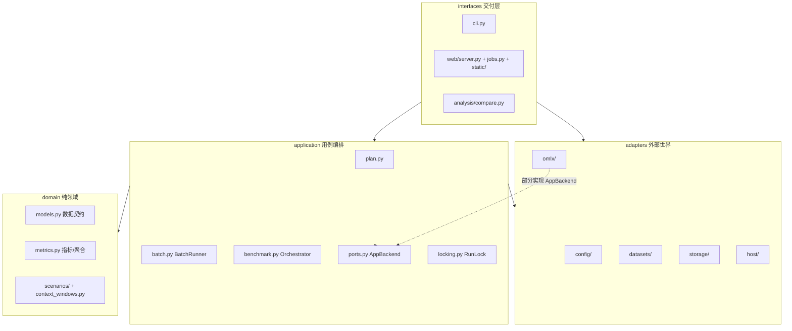

**依赖规则（目标态与当前实现）**

1. `domain/` 不 import `application/`、`adapters/`、`interfaces/`；可独立单测。
2. `application/` 负责编排；**目标态**是只依赖 `domain/` 契约与 `ports.AppBackend`，不直接拼
   HTTP/YAML/文件格式。**当前实现**为组装便利直接使用 `adapters.config/datasets/omlx/storage/host`，
   完全端口化是 P1 技术债（见 §8.2、§9）。
3. `adapters/` 封装外部世界（oMLX、数据集、存储、主机观测）；新增后端主要改这里。
4. `interfaces/` 只做输入解析与展示；Web Job 复用 `application.batch/benchmark`，不复制测量逻辑。
5. `resources/config/` 是数据不是代码；通过 `paths.py` 定位。

**已知偏差（诚实记录）**

- `application/benchmark.py`、`batch.py`、`plan.py` 仍直接 import 具体 adapters（omlx/config/
  storage/datasets），`AppBackend` 协议尚未注入；`ports.py` 已有协议，但解耦仍是 P1 技术债。
- `OMLXBackend` 继承 `OMLXClient` 并以鸭子类型满足 `AppBackend` 的方法集合，未显式
  `class OMLXBackend(AppBackend)`；`isinstance(..., AppBackend)` 不成立。
- `interfaces/web/jobs.py` 直接构造 `OMLXBackend`（组装根），这是交付层允许的组装职责；
  但 `benchmark.py` 的直连是分层例外，见 §9。

### 3.2 模块职责

| 模块 | 职责 | 关键对象/入口 |
|---|---|---|
| `domain/models.py` | 全部持久化数据契约与枚举 | `Sample`、`RequestSpec`、`SampleRecord`、`PerfMetrics`、`CellAggregate`、`OverallAggregate`、`RunManifest`、`SCHEMA_VERSION` |
| `domain/metrics.py` | 指标公式、cell/overall 聚合、逐样本投影 | `compute_metrics`、`aggregate_records`、`aggregate_overall`、`sample_results` |
| `domain/context_windows.py` | 上下文档位窗口筛选 | `normalize_windows`、`in_context_windows`、`describe_windows` |
| `domain/scenarios/` | 场景→请求构建、抽样、可选判分 | `ScenarioAdapter`、`deterministic_sample`、`stratified_sample`、`registry` |
| `domain/evaluators/` | 纯函数判分器（有实现，当前不接入 run） | 数学/代码等 judge 有实现；accuracy 侧部分 judge 仍仅契约 |
| `application/ports.py` | 应用后端协议 | `AppBackend`、`ModelInfo`、`BackendError` |
| `application/plan.py` | 测试集应用、模型/场景选择、计划概览 | `apply_testset`、`plan_overview`、`dataset_plan` |
| `application/batch.py` | 一次动作→每模型一个 bundle；批次元数据/索引刷新/锁 | `BatchRunner` |
| `application/benchmark.py` | 模型生命周期、逐样本执行、缓存治理、取消、落盘 | `Orchestrator`、`RunCancelled`、`RunStats` |
| `application/locking.py` | 跨进程文件锁（按 output 根） | `RunLock`、`RunLockError` |
| `adapters/omlx/client.py` | oMLX HTTP/SSE 客户端与计时 | `OMLXClient`、`StreamResult`、`OMLXError` |
| `adapters/omlx/backend.py` | 后端适配 + 设置应用 | `OMLXBackend` |
| `adapters/omlx/cache.py` | 冷/温缓存治理与污染判定 | `CacheController` |
| `adapters/omlx/environment.py` | oMLX 配置/设置/feature flags 快照 | `collect_omlx_environment`、`default_settings_repair` |
| `adapters/config/` | YAML 配置/测试集加载、模型清单同步 | `load_config`、`load_testsets`、`sync_models_file` |
| `adapters/datasets/` | 11 个数据集适配器 + 注册表 + 下载 helper | `DatasetAdapter`、`get_adapter`、`perf_jsonl` |
| `adapters/storage/` | 输出布局、内容寻址 blob、run bundle、目录索引、派生工具、Excel | `layout`、`PromptBlobStore`、`RunWriter`、`catalog`、`tools`、`excel_report` |
| `adapters/host/` | 硬件档案、CPU/RSS/phys_footprint 采样、文件锁原语 | `collect_hardware_profile`、`ResourceSampler`、`filelock` |
| `interfaces/cli.py` | 命令行入口与预检 | `run/validate/web/list/...` |
| `interfaces/web/` | 本地控制台 HTTP API + JobManager + 静态页 | `server.py`、`jobs.py`、`static/` |
| `interfaces/analysis/` | 多 run 对比 | `compare.py` |
| `harness/` | 门禁、任务板、文档契约、结构生成 | `gate.py`、`taskctl.py`、`docs_contract.py` |

### 3.3 核心领域模型

**图 3-2 核心领域模型关系**

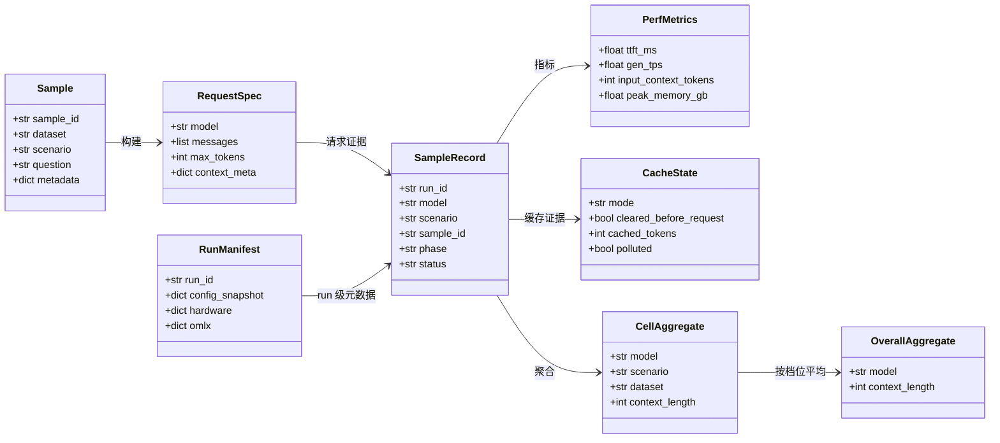

| 对象 | 作用 | 关键不变量 |
|---|---|---|
| `Sample` | 数据集归一化样本：`sample_id/dataset/scenario/question/context/answer/tools/metadata` | `sample_id` 稳定；预构造样本带 `metadata.context_length/tokens/prebuilt` |
| `RequestSpec` | 场景→客户端的精确请求：messages/tools/max_tokens/chat_template_kwargs | 记录实际 prompt token；`target_context_tokens` 在性能模式恒为 `None` |
| `StreamResult` / `Usage` | 客户端流式结果：文本/推理/工具调用/时间戳/usage | `cached_tokens` 缺失不能被当作 0 |
| `SampleRecord` | 最小审计单元：请求、响应、指标、缓存、模型快照、phase/status | 每条 measured 记录必须有 `input_context_tokens` |
| `PerfMetrics` | TTFT/TPOT/E2E/gen_tps/prefill_tps/CPU/RSS/峰值内存/输入上下文/`decode_window_ms`/`gen_tps_invalid` | `gen_tps/tpot` 仅可信解码窗口输出；被抑制时记原因 |
| `CellAggregate` | `model×scenario×dataset×context_length` 聚合 | 只聚合 measured+OK；污染/错误/warmup 排除 |
| `OverallAggregate` | `model×context_length` 主结果 | 绝不跨 1K/8K/32K 合并 |
| `SampleResult` | `samples.csv` 的逐样本投影 | 包含 `finish_reason/length_capped/truncated` |
| `RunManifest` | 配置、硬件、oMLX、模型、git、时间 | 密钥脱敏；可离线复现实验条件 |

### 3.4 聚合与指标口径

| 指标 | 计算 | 输出条件 |
|---|---|---|
| `ttft_ms` | 首个 token 时间戳 − 请求开始（客户端 `perf_counter`） | 有首 token |
| `ttft_visible_ms` | 首个可见 content 时间戳 − 请求开始 | 有可见 content |
| `tpot_ms` | `(last_token − first_token) / (completion_tokens − 1) × 1000` | `completion_tokens >= 16` 且窗口 ≥50ms、非 tool_calls、值 ≤10,000；被抑制时 `gen_tps_invalid` 记原因 |
| `gen_tps` | `(completion_tokens − 1) / (last_token − first_token)` | 同上（可信解码窗口） |
| `prefill_tps` | `prompt_tokens / ttft_s` | `ttft_s > 0` 且有 prompt tokens |
| `total_tps` | `(prompt_tokens + completion_tokens) / e2e_s` | `e2e_s > 0` |
| `input_context_tokens` | usage 的 `prompt_tokens`；缺失回落 `request.tokenized_prompt_tokens`/声明值 | measured 记录必须可追溯 |
| `isl_tolerance` | `context_meta.isl_tolerance{target,low,high,actual,ok}`；目标模型 tokenize 实际值 vs bucket target ±10% 带（`window_check_basis` 说明判定依据） | 每条预构造 measured 记录；**只用于 `samples.csv.isl_band` 与入带/出带计数，不触发跳过** |
| `isl_band` | actual 是否在 target ±10% 带内（`samples.csv` 列） | **只有入带样本进入 averages**；出带保留但不进均值 |
| `peak_memory_gb` | oMLX 进程树 `phys_footprint` 峰值；非 macOS 回落 RSS | macOS 优先；缺失允许 `None` |
| `peak_cpu_pct` | 进程树 CPU 峰值；100% = 一个核满载 | 采样成功 |

**聚合层级**

1. `SampleRecord`：一条 measured 请求，权威证据。
2. `CellAggregate`：`(model, scenario, context_length, dataset)`；默认 24 cells/模型。
3. `OverallAggregate`：`(model, context_length)`；1K/8K/32K 分行，不做“模型全局平均”。

`Distribution` 的字段：`n/mean/median/std/min/max/p95` + **`ci95_low`/`ci95_high`**
（run 内 mean 的正态近似 95% CI：`mean ± 1.96·std/√n`，`n<2` 为 null；**只表示 run 内
抽样不确定性，不是 run-to-run 噪声**，跨 run 复现性需 `repeats≥2` 或配对比较）。

**有效性判定**：`phase == measured` 且 `status == ok` 才进入聚合；`warmup`、`contaminated`、
`error`、`timeout` 排除；`finish_reason=length` 的样本**不丢弃**，按实际生成 token 计算
`gen_tps/tpot`，并计入 `n_length_capped`。`gen_tps/tpot` 仅在可信解码窗口输出，否则
`gen_tps_invalid` 记原因（枚举与判定优先级见 [20-methodology.md](../spec/20-methodology.md) §2/§8），聚合输出 `n_gen_tps_invalid` 且 `verify` 拒绝
`gen_tps>10,000` 或 `<0`。actual ISL **不触发跳过**：所有能测样本都 measured；aggregate
只使用 actual 在 target ±10% 带内的入带样本，出带样本保留但不进均值；计数
`n_isl_in_band`/`n_isl_out_of_band`（outcome 与 aggregates 行都有），in-band 样本不足时
标记 `insufficient_samples`。`stability_cv = std(TTFT)/mean(TTFT)`，`>0.2` 标记
`unstable`（仅提示，不自动剔除）。

### 3.5 端口、适配器与注册表（ADR-05）

**图 3-3 端口、适配器与注册表**

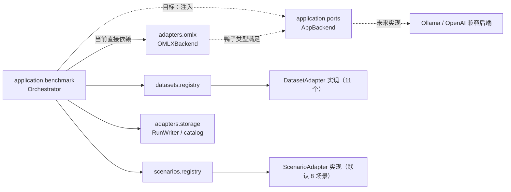

> 现状提示：`AppBackend` 端口已定义，`REQUIRED_BACKEND_METHODS`/`backend_contract_errors()`
> 提供可执行的结构契约；但 Orchestrator 仍直接依赖 `OMLXClient` 并调用端口外能力，
> 新增后端前应完成 P1 解耦（见 §8.2、§9），否则“只换适配器”并不成立。

**`AppBackend` 能力清单**

| 方法 | 用途 |
|---|---|
| `probe()` | 健康/鉴权/版本自检，无副作用 |
| `list_models()` / `model_info()` | 模型发现与单模型状态 |
| `apply_model_settings()` | 应用 per-model 设置（当前仅 MoE） |
| `load_model()` / `unload_model()` | 生命周期 |
| `wait_until_loaded()` / `wait_until_unloaded()` | 轮询等待 |
| `clear_caches()` | 清 hot+SSD（冷测量前提） |
| `tokenize_messages()` | 精确 prompt token 计数 |
| `chat_stream()` | 流式推理，返回 `StreamResult` |
| `close()` | 释放连接 |

**结构契约（可执行，非仅约定）**：`application/ports.py` 定义
`REQUIRED_BACKEND_METHODS`（上表 12 个方法）与 `backend_contract_errors(backend)`——
按**鸭子类型**检查每个成员存在且可调用，**不强制** `OMLXBackend` 继承 ABC；
`test_core.py::test_omlx_backend_implements_application_port_contract` 断言内置后端全方法通过。
新增后端时在组装/测试中调用 `backend_contract_errors()` 即可得到缺失清单。

**当前 Orchestrator 实际使用但不在 `AppBackend` 的能力（P1，后端扩展阻塞）**

| 能力 | 调用点 | 影响 |
|---|---|---|
| `models_status()` | 生命周期/隔离/等待/Web 清单 | 新后端仅实现端口会缺方法 |
| `loaded_models()` | `isolate_models` / `restore_state` | 无法判断哪些模型已加载 |
| `model_config()` | 上下文窗口/loaded 快照 | 无法构建请求/判断加载态 |
| `discover_server_pid()` | CPU/RSS 采样 | 采样不可用 |
| `update_model_settings()` | 默认配置修复的 fallback（无 `apply_model_settings` 时） | 设置无法应用 |

> 结论：**结构契约已可执行**（`backend_contract_errors()` + `test_core` 全方法测试），但完整
> 替换仍受 Orchestrator 直连与端口外能力限制；按 §5.5 接入新后端前必须先完成 T-004。

**注册表与扩展契约**

- `DatasetAdapter`：必须实现 `ensure_downloaded()` 与 `load()`；可选 `plan()` 用于无扫描估算；
  必须确定性（相同参数返回相同顺序）。
- `ScenarioAdapter`：必须实现 `build_request()` 与 `score()`；`agentic=True` 时可用
  `execute_tool()`；性能样本默认 `prebuilt`，不会触发工具循环。
- 注册表：`adapters/datasets/registry.py`、`domain/scenarios/registry.py`；新增实现后注册即可，
  runner 不写 `if scenario` 分支。

### 3.6 配置模型

| 文件 | 内容 | 加载入口 |
|---|---|---|
| `src/modelbench/resources/config/default.yaml` | server / perf / run / datasets / models_file / scenarios_file | `load_config()` |
| `src/modelbench/resources/config/models.yaml` | 模型 id、alias、enabled、`load.settings`（仅 MoE）、notes | `load_config()` |
| `src/modelbench/resources/config/scenarios.yaml` | 8 个默认场景 → `perf_jsonl` 切片 + `dataset_params` | `load_config()` |
| `dataset/test/<name>/testset.yaml` | 命名测试集：场景集合与 dataset/params 覆盖 | `load_testsets()` + `apply_testset()` |
| 环境变量 | `OMLX_API_KEY`、`OMLX_ADMIN_API_KEY` 等 | `ServerConfig` / `resolve_*_key()` |

**优先级**：配置项为默认 YAML < CLI/Web 显式覆盖；API key 另按“显式配置 → 环境变量 →
本地 oMLX 设置”解析。配置在 run 开始时快照进 `run.json.config`（密钥脱敏），因此结果可回答
“当时用了什么配置”。

**关键配置项**

- `perf.samples_per_dataset` / `perf.samples_by_scenario` / `perf.sample_ids`：样本选择优先级；
- `perf.context_windows`：只筛样本，不改变 cell 键；
- `perf.max_tokens`（默认 50）与 `perf.decode_guard`（默认 true）；
- `run.cache_mode`、`run.repeats`、`run.warmup_requests`、`run.warmup_per_model`、
  `run.max_retries`、`run.retry_backoff_s`、`run.max_contamination_retries`、`run.max_requests`、
  `run.fail_fast`、`run.seed`、`run.cpu_sample_interval_ms`；
- `run.isolate_models` / `run.restore_state`：模型隔离与复原（缓存清理不受 `restore_state` 控制）；
- `run.thinking_mode`；`run.context_safety_margin_tokens`。

### 3.7 逻辑层关键不变量

1. 性能模式不判分：`SampleRecord.score` 恒为 `None`，evaluator 域不接入 run。
2. 预构造样本禁止静默截断：放不下时抛 `ValueError` → 样本级 `skipped`，而不是改 prompt。
3. 输出达到 `max_tokens` 是正常测量：保留 `finish_reason=length`，`gen_tps` 用实际 token。
4. 上下文窗口筛选只影响“选哪些样本”，不影响 cell 键；cell 始终带 `context_length`。
5. 抽样确定性：预构造样本先按档位、再按语言两级最大余数分配（与 `perf_jsonl.plan` 同一实现）；legacy 按 `sample_id`。
6. 聚合只能由逐样本记录复算：`samples.csv`/`aggregates.json` 由 `records.jsonl` 中的
   measured 记录投影得到（`./modelbench rebuild` 可重建），不允许另存一套无法回溯的平均值。
7. 同一 run 的 `batch` 元数据只做分组，不改变单模型 bundle 的 schema。

### 3.8 数据契约演进

- 当前 `SCHEMA_VERSION = 3.0`、`INDEX_SCHEMA_VERSION = 2.0`（两个版本号独立演进：前者是 run bundle
  内容格式，后者仅 `output/index.json`）。
- 3.0 与 2.x **不兼容**：旧 bundle 整体移入 `output/archive/legacy-v2/`，不参与新索引，读取侧不再
  保留兼容分支（见 §9）。
- 破坏性字段变更必须升版本，并同步 `docs/design/31-output-contract.md`、Web 读取逻辑与测试。
- 已知缺口：读取侧不再兼容 2.x；旧 bundle 归档保留，如需在新布局下浏览需一次性重序列化（P1，见 §9）。

---

## 4. 过程视图

### 4.1 运行时进程/线程拓扑

**图 4-1 运行时进程/线程拓扑**

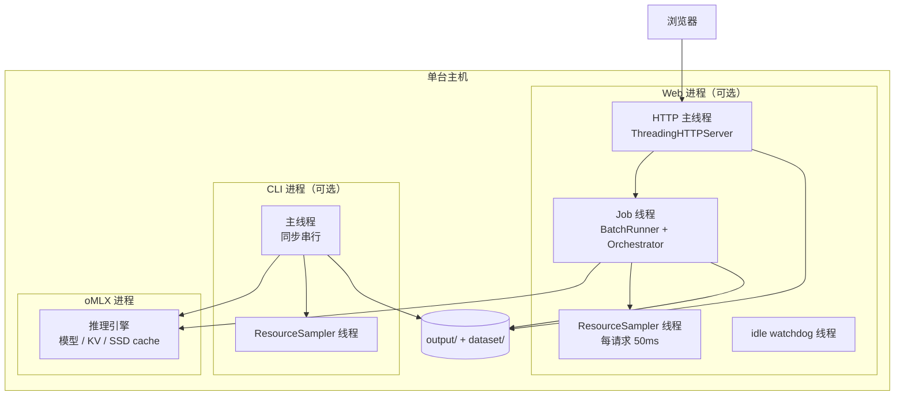

**特征**

- **同步、串行**：推理请求在 CLI 主线程/Job 线程内同步执行；没有 asyncio、线程池并发请求。
  `ThreadingHTTPServer` 只并发处理“轻量 API”，不并发 benchmark。
- **一个 job 一个线程**：`JobManager.create()` 启动 daemon 线程；job 线程内部等待 `_run_lock`。
- **一个请求一个采样线程**：`ResourceSampler` 在请求开始时启动、结束时 join；采样线程只读
  `psutil`，不接触请求内容。
- **idle watchdog**：可选线程；无请求且无运行 job 时 `server.shutdown()`。
- **进程边界**：Web 服务、CLI、oMLX 是不同进程；模型/缓存状态在 oMLX 进程内，因此必须串行。

### 4.2 一次 run 的编排状态机

**图 4-2 一次 run 的编排状态机**

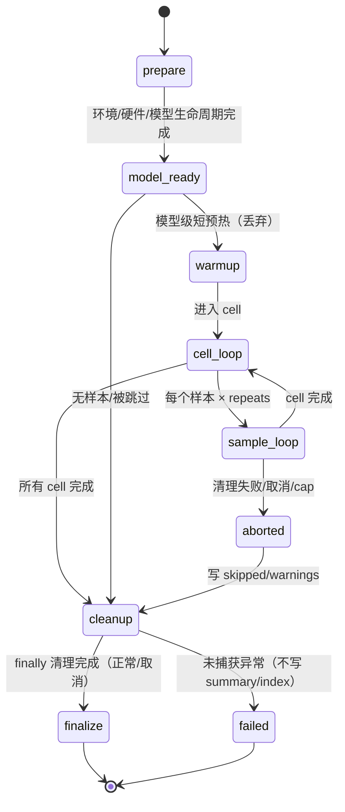

**顺序约束**（不可交换）

1. `prepare()` 必须先采集环境/硬件/初始 feature flags；否则 manifest 无法解释测量条件。
2. 模型生命周期必须先完成，才能发 warmup/measured 请求。
3. 模型级 warmup 必须早于第一个 measured cell；它被丢弃且不记录。
4. 每个 cell 的样本必须按 `(dataset, context_length)` 分组；聚合键与分组键必须一致。
5. **cleanup 先于 finalize**：`finally` 里执行缓存清理、`restore_state`、`writer.close()`；
   之后才 `finalize()` 复算聚合、写 CSV/report/analysis、更新索引。
6. **finalize 之后不再有外部副作用**（索引更新是最后一步）；未捕获异常会跳过 finalize，
   只留下部分 bundle，由 batch 记为失败。

**两种 warmup 语义不同**：模型级 `run.warmup_per_model` 的短请求**不写** `records.jsonl`；
per-cell `run.warmup_requests` 会写 `phase=warmup` 记录，但不进聚合。审计时不要把两者混为一谈。

### 4.3 串行化与锁（ADR-03）

| 层级 | 机制 | 作用域 | 行为 |
|---|---|---|---|
| Web 进程内 | `JobManager._run_lock` | 同一 Web 服务进程 | 后来的 job 排队，`status=queued` |
| 跨进程（output 根锁） | `RunLock(<output>/.state/benchmark.lock)` | 同一 output 根目录 | 非阻塞；**先取 endpoint 锁再取本锁**；占用时 `RunLockError` 快速失败并提示 PID |
| 跨进程（endpoint 锁） | `RunLock(modelbench-locks/<sha256(normalized base_url)[:16]>.lock)`（系统临时目录；normalize = scheme+host+port） | 同一 oMLX 实例（任意 output 根） | 非阻塞；同一 `base_url` 的两个 run 互斥，不同 `base_url` 可并发 |
| 跨 oMLX 实例 | 由 endpoint 锁键区分 | 不同 `base_url` | 可并发（模型/缓存互不影响） |
| oMLX 模型状态 | `isolate_models=true` + unload/wait | 同一 oMLX 实例 | 测量前卸载其它模型；测量后 `restore_state` |
| 输出目录 | `RunWriter` 存在性检查 + `overwrite` | 单个 run | 已存在且未 `--overwrite` → `FileExistsError` |
| 索引写入 | `catalog` 文件锁 + 原子替换 | `output/index.json` | 并发读安全；写失败会使该模型在 batch 中记为失败（bundle 其他文件已落盘） |

**图 4-3 双层锁与 job 排队时序**

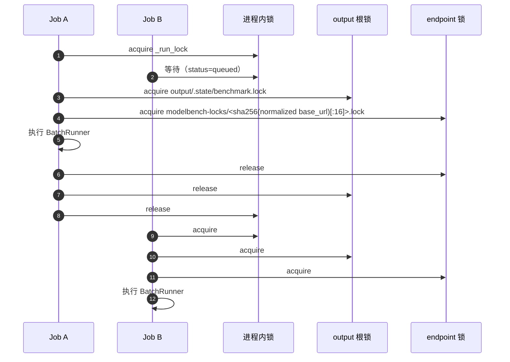

**为什么必须双锁**：Web 进程内锁只解决“同一个控制台点了两次”；CLI 与 Web、或两个终端
仍可能并发，而 oMLX 的模型/缓存是全局状态。**output 根锁**防目录写冲突；**endpoint 锁**
按规范化 `server.base_url` 的 SHA-256 前 16 位放在系统临时目录（`modelbench-locks/`），
保证同一 oMLX 实例即使使用不同 output 根也互斥；不同 endpoint 则天然可并发。
两把锁都是非阻塞的 fail-closed：占用/不支持文件锁时直接拒绝启动，而不是“尽力而为”。

### 4.4 缓存治理与污染判定

**图 4-4 缓存治理与污染判定**

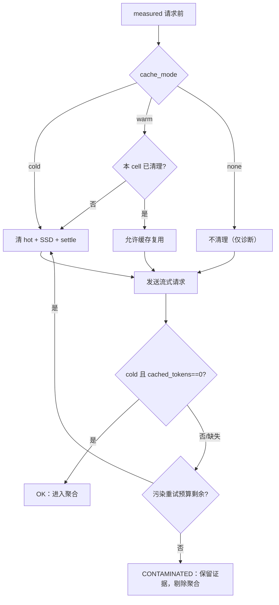

**规则**

1. `cold`：每次 measured 前清理；清理失败 → **中止 cell**，不产生“可能暖缓存”的结果。
2. `cold`：`cached_tokens` 缺失也判污染（fail-closed），因为无法证明冷。
3. 污染重试有独立预算 `run.max_contamination_retries`（默认 1）；耗尽后记录
   `status=contaminated`，保留在 `records.jsonl`，不进聚合。
4. `warm`：每 cell 只清一次，之后允许命中；warm 结果不得与 cold 混算。
5. `none`：仅诊断；结果不能作为对外性能结论。
6. 清理/评估失败都是**显式证据**：`CacheState.note`、`summary.warnings`、日志。

### 4.5 单请求执行、重试与记录

**图 4-5 单请求执行、重试与记录**

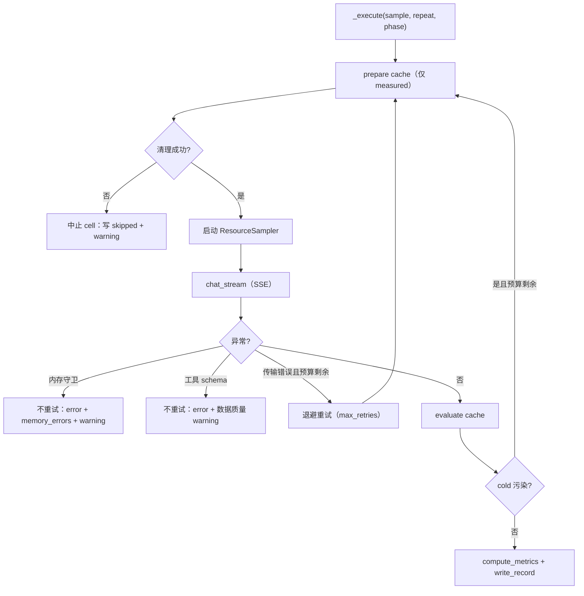

**重试分类**

| 类别 | 判定 | 是否重试 | 记录 |
|---|---|---|---|
| 传输/超时 | `timeout`、连接错误 | 是，`run.max_retries`（默认 2） | `error`/`timeout` |
| 冷缓存污染 | `cached_tokens>0` 或缺失 | 是，`max_contamination_retries`（默认 1） | `contaminated` |
| 内存守卫 | `prefill_memory_exceeded`、507 等 | **否**（确定性失败） | `memory_errors` + warning |
| 工具 schema 错误 | `invalid tools` 等 | **否**（数据质量问题） | error + warning |
| 其它异常 | 未分类 | 预算内重试 | error |

**关键点**：传输重试与污染重试使用**独立预算**，避免“污染重试被传输重试耗尽”导致日志说重试
但实际没发请求（历史缺陷已修复）。

### 4.6 取消与逐样本跳过

**图 4-6 取消与跳过记录**

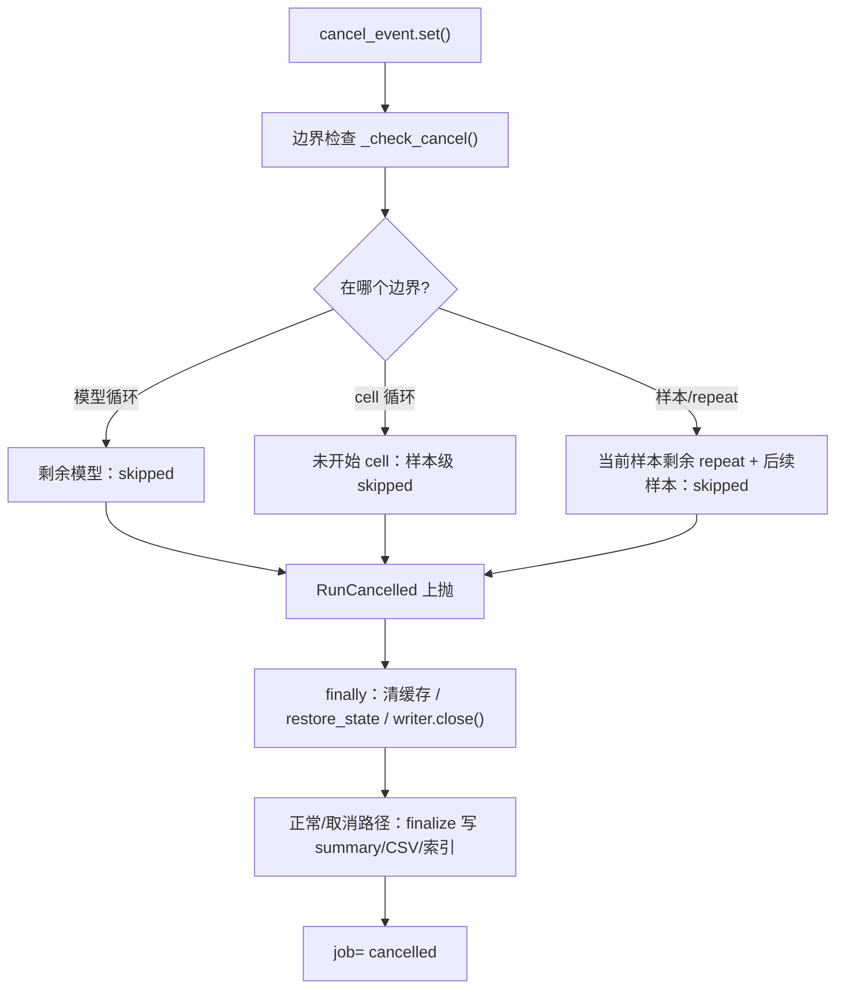

**跳过语义**：`run.json.outcome.skipped` 是字符串列表，但必须能定位到 `scenario/label/sample/repeat` 或
`model/scenario`；不允许只写“cancelled”。取消/中止路径按 repeat 记录；`max_requests` 截断
按样本记录（默认 `repeats=1` 时无歧义，>1 时不逐 repeat 展开）。未找到样本 id、上下文窗口
筛空、模型失败等同样写 `skipped`。

### 4.7 资源采样与内存口径

| 观测 | 方法 | 频率/窗口 | 备注 |
|---|---|---|---|
| CPU | `psutil` 进程树 CPU 时间差 | 每请求，默认 50ms | 100% = 一个核 |
| RSS | 进程树 RSS 求和 | 每请求 | 跨平台回退值 |
| `phys_footprint` | macOS `proc_pid_rusage(RUSAGE_INFO_V4)` | 每请求 | 含 Metal/IOAccelerator；与 oMLX `PeakMem` 不同 |
| 模型加载内存 | 加载前 baseline / 加载后 idle 的进程树快照 | 每模型一次 | 写入 `run.json.env.omlx` 的模型 `memory` |
| 缓存清除耗时 | `client.clear_caches()` 的 hot+SSD 两次 POST 计时 | cold 每 measured 请求；warm 每 cell 一次 | 写入 `CacheState.clear_latency_ms`，不含 `cache_settle_ms` 睡眠 |
| 服务端 PID | pid file 或 `lsof -iTCP:<port>` | run 开始一次 | 找不到则 CPU 采样跳过并 warning |

**限制**：采样是外部观测，不能替代 oMLX 内部 `mlx.core.get_peak_memory()`；报告中必须说明口径，
不能与 oMLX 官方 `PeakMem` 直接横比。

### 4.8 进度事件协议（Web）

| 事件 | 关键字段 | 消费者行为 |
|---|---|---|
| `run_start` | `run_id` | 标记开始 |
| `model_start` | `model/index/total` | 标记模型开始 |
| `model_done` | `model/index` | `models_done` 累计 |
| `cell_start` | `model/scenario/dataset/context_length/samples/repeats/cell_index/cell_total` | 初始化当前 cell 的 `done/total` |
| `record` | `status/input_context_tokens/ttft_ms/gen_tps/peak_memory_gb` | 非 warmup 时 `records += 1`、cell `done += 1` |
| `cell_done` | 同上 | `cells_done += 1` |
| `batch_model_start` / `batch_model_done` | `batch_id/method/model/run_id/run_dir` | 更新 job 的 batch/run 信息 |
| `batch_done` | batch summary | job 完成 |

**一致性**：`Job.snapshot().progress.percent` 优先用 `samples_total` 计算；未知时用
`cells_done + 当前 cell 比例` 估算，并明确 `cells_total` 来源。前端只读 API，不推断后端状态。

### 4.9 运行期故障矩阵

| 故障 | 检测点 | 行为 | 证据 |
|---|---|---|---|
| oMLX 不可达 | CLI `probe()` / job 开始 | CLI 退出码 3；Web job 通常 `done`（`fail_fast=true` 时 `failed`），模型级 `skipped` | `job.error`/`run.json.outcome.skipped` |
| API key 无效 | `probe().ok_auth` | 拒绝启动 | CLI 退出码 3 |
| 模型不在服务端 | `/v1/models` 预检 | 400 / 退出码 3 | 缺失模型列表 |
| 模型加载超时 | `wait_until_loaded` | warning；后续请求可能失败 | `warnings`、`skipped` |
| 设置应用失败（optional） | `apply_model_settings` | warning，继续测量 | `warnings` |
| 缓存清理失败 | `CacheController.clear` | 中止 cell，剩余样本 `skipped` | `CacheState.note` |
| 冷缓存命中/缺失 | `evaluate()` | 污染重试/标记 contaminated | `status` |
| 内存守卫拒绝 | 错误文本匹配 | 不重试，`memory_errors += 1` | `run.json.outcome.memory_errors` |
| 工具 schema 错误 | 错误文本匹配 | 不重试，数据质量 warning | `warnings` |
| 输出目录已存在 | `RunWriter` / batch 预检 | `FileExistsError` | 退出码 1 / job failed |
| 另一个 run 持有锁 | `RunLock` | 快速失败，提示 PID | `RunLockError` |
| 用户取消 | `cancel_event` | 协作停止，写 skipped，清理 | `run.json.outcome.cancelled` |
| `max_requests` 截断 | 记录计数 | 剩余样本/模型 `skipped` | `run.json.outcome.skipped` |
| Excel 导出失败 | `export-analysis`（按需） | 不影响证据；修复后重跑 | CLI 退出码 1 |
| 索引刷新失败 | `catalog.upsert_run/upsert_batch` | 警告并继续（索引可重建） | `stderr`/`warnings` |

### 4.10 非协作中断与部分 bundle

| 中断/崩溃 | 已落盘 | 未落盘/后果 | 处置 |
|---|---|---|---|
| 用户取消（协作） | 已写 `records.jsonl`（逐条 flush）与 `blobs/prompts` | 当前/后续样本写 `skipped` | finally 清理；正常/取消路径 finalize 写 `MANIFEST.json`/索引 |
| `SIGINT`（Ctrl+C） | 同上 | CLI：`KeyboardInterrupt` → 退出码 130，不写批次元数据；Web：未捕获异常可能跳过 finalize | bundle 可能无 `MANIFEST.json`/索引项；可用 `./modelbench verify`/`rebuild` 判定与恢复 |
| `SIGKILL`/断电 | 已 flush 的 `records.jsonl` 行、blob | 无 `MANIFEST.json`/索引；锁由 OS 释放 | 孤儿 run 目录不进 `runs[].files`；`verify` 报缺 `MANIFEST`，`rebuild` 可重建派生文件 |
| Web 服务重启 | 磁盘 bundle 不变 | `JobManager.jobs` 是内存字典，job 历史丢失 | 页面无法恢复旧 job；只能从 `output/index.json` 看已完成 run |

**结论**：`records.jsonl` 逐条 flush，但 `MANIFEST.json`/索引只在 `finalize()` 写；崩溃后的 bundle
可能不完整。`./modelbench verify` 可检出、`./modelbench rebuild` 可从 `records.jsonl` 重建派生文件；
仍没有 job 状态持久化与孤儿目录自动清理，见 §9。

---

## 5. 开发视图

### 5.1 代码组织

```text
src/modelbench/
  domain/            # 纯领域：数据契约、指标、场景、判分
  application/       # 用例编排：plan / batch / benchmark / ports / locking
  adapters/          # 外部世界：config / datasets / omlx / storage / host
  interfaces/        # 交付层：cli / web / analysis
  resources/config/  # 随包 YAML
  paths.py           # 项目根/资源定位
harness/             # 门禁、任务板、文档契约
tool/                # 数据集构建/校验、下载工具、bootstrap（不参与运行时）
test/                # 单元 + fake-server 集成测试
dataset/             # 输入/证据（只读；测试集 YAML 随仓库提交）
output/              # 结果 bundle（gitignore）
```

完整文件清单见 [33-project-structure.md](33-project-structure.md)（自动生成，不手改）。

### 5.2 依赖、构建与启动器

| 项 | 内容 |
|---|---|
| Python | `>=3.10`（推荐 3.12） |
| 运行时依赖 | `httpx`、`pydantic>=2.6`、`PyYAML`、`psutil`、`numpy`、`openpyxl` |
| 开发依赖 | `pytest`、`pytest-timeout` |
| 数据集构建 extras | `pyarrow`、`tokenizers`、`jinja2`（`.[datasets]`） |
| 打包 | `pyproject.toml` + setuptools src 布局；资源随包（`resources/config/*.yaml`、Web 静态文件） |
| 入口 | 根启动器 `./modelbench`（POSIX）、`modelbench.cmd` / `modelbench.ps1`（Windows）；无 console script |
| 环境 | `.venv` 项目内；`./modelbench setup` 创建/修复；不要把 `.venv` 跨机器复制 |
| 常用命令 | `make check`（全门禁）、`make test`、`make docs`、`make docs-write`、`make build` |

### 5.3 测试策略

> 下表文件均位于 `test/`；跨文件引用时统一用 `test/<file>.py`。

| 测试文件 | 关注点 |
|---|---|
| `test/test_integration.py` | fake oMLX server 全流程：逐样本记录、冷缓存、环境文件、取消、无判分 |
| `test_perf.py` | perf 配置矩阵、抽样/分层、计划、上下文窗口、`max_tokens` 语义 |
| `test_core.py` | 领域模型、指标公式、聚合、无跨档合并 |
| `test_batch.py` | 批处理、run_id、锁、失败隔离、Excel 失败降级 |
| `test_results.py` | bundle、catalog、CSV/report、索引一致性 |
| `test_model_catalog.py` | 模型清单解析/同步/差异 |
| `test_datasets.py` / `test_perf_dataset.py` | 运行时适配器、性能测试集构造与校验 |
| `test_web_console.py` | `/api/overview`、`/api/estimate`、run/cancel、路径安全 |
| `test_entrypoints.py` / `test_bootstrap.py` | 根启动器、跨平台脚本、环境自举 |
| `test_evaluators.py` | 判分器契约（虽不接入 run） |
| `test_harness.py` / `test_docs_contract.py` | 门禁、文档契约 |

**测试原则**：新逻辑覆盖空/缺失/歧义/超时/失败；改 runner/cache/writer 必须扩展 fake-server
用例；改配置/测试集/样本选择必须更新矩阵断言；测试是契约，不删除/弱化。

### 5.4 门禁与文档契约（ADR-09）

`./modelbench` 之外，质量由 `python -m harness.gate` 统一把关：

| 检查 | 内容 | 失败含义 |
|---|---|---|
| `imports` | 导入全部包；注册表 ≥11 datasets / ≥8 scenarios | 循环依赖/语法/注册缺失 |
| `compile` | `compileall src/ harness/ tool/ test/` | 语法错误 |
| `tests` | `pytest test/` | 行为回归 |
| `validate` | `validate --offline`（配置/数据集/测试集） | 配置或数据不可用 |
| `dataset_integrity` | 结构/manifest/SHA-256（数据缺失时 CI 跳过） | 数据被改写/缺失 |
| `perf_plan` | 性能计划可解析（无策略/矩阵） | 计划/配置漂移 |
| `docs_links` | 所有相对 Markdown 链接存在、无绝对链接 | 文档链接失效 |
| `docs_contract` | 模块/路径/`make` 目标/CLI flag/结构清单 | 文档与代码漂移 |
| `secrets` | 跟踪文本中无凭据字面量 | 密钥泄漏 |
| `hygiene` | gitignore/布局/打包不变量 | 提交/布局违规 |
| `live_smoke` | 真实 oMLX 小样本冒烟（`--live`） | 真实链路不可用 |

**文档契约细节**（`harness/docs_contract.py`）：文档中反引号里的 `src/...`、`docs/...` 等路径
必须存在；`python -m <module>` 必须可导入；`make <target>` 必须存在；`./modelbench <cmd> --flag`
必须在 `--help` 中；`docs/design/33-project-structure.md` 必须与 `harness.gen_structure` 输出一致；
禁止旧路径词（如已删除的旧目录名）。因此改结构后必须 `make docs-write`。

### 5.5 扩展点

| 扩展 | 做法 | 不要做什么 |
|---|---|---|
| 新数据集 | 实现 `DatasetAdapter.ensure_downloaded/load`，在 `datasets/registry.py` 注册；可选 `plan()` | 不要在 runner 里写数据集分支 |
| 新场景 | 实现 `ScenarioAdapter.build_request/score`，在 `scenarios/registry.py` 注册 | 不要复制 Orchestrator 逻辑 |
| 新应用后端 | 先完成 P1 解耦；实现 `AppBackend` 的**结构契约**（`REQUIRED_BACKEND_METHODS`，`backend_contract_errors()==[]`）并补齐 `models_status/loaded_models/model_config/discover_server_pid`（或拆 `ModelLifecycleBackend`），在组装根注入 | 不要把 Ollama/vLLM 逻辑塞进 oMLX 模块；不要只实现当前端口方法（结构契约与能力缺口都要过） |
| 新测试集 | 在 `dataset/test/<name>/` 建 `testset.yaml` + 数据；`datasets.testset_dir` 可改根 | 不要改默认 performance 测试集语义（需人类确认） |
| 新模型 | `resources/config/models.yaml` 增加 id/alias/enabled；仅 MoE 可加 `load.settings` | 不要写加速开关或非默认设置 |
| 新判分（离线） | `domain/evaluators/` 纯函数，输入 `Sample` + `RawResponse` | 不要接入默认性能 run（会改变 `score` 语义） |
| 新结果分析 | 读 `aggregates.json` 的 `overall`/`cells` 与 `samples.csv` 逐样本表 | 不要跨 `context_length` 合并；不要回读大 `records.jsonl` 求均值 |
| 新 Web 页面/API | `interfaces/web/server.py` + `static/`；复用 `plan_counts` 与 Web 的 `build_config` 语义 | 不要复制测量逻辑或绕过 JobManager |

### 5.6 编码与协作约定

1. **类型与契约**：持久化对象用 pydantic；跨层传 `domain` 模型，不传原始 dict。
2. **IO 边界**：`domain` 无网络/文件 IO；`adapters` 承担所有外部 IO；`application` 只编排。
3. **错误处理**：不静默降级；失败必须进 `status/skipped/warnings/log`；确定性失败不重试。
4. **确定性**：抽样、排序、run_id、CSV 字段顺序必须稳定；不要依赖 dict 插入顺序做业务语义。
5. **多 Agent**：一个任务一个 owner；`scope` 是写作用域；验证者只读（`/tmp` 或报告），
   不得自写自判；实现者与验证者分离（见 [AGENTS.md](../../AGENTS.md) §6）。
6. **提交前**：`pytest test/` 全绿、**完整** `harness.gate` PASS（10 项默认检查；
   `--only` 子集报告不能用于 `taskctl complete --gate`）、文档同步、`taskctl complete --gate`、
   git commit（不含 `dataset/raw`、`output/` 证据）。

---

## 6. 物理视图

### 6.1 部署拓扑

**图 6-1 部署拓扑**

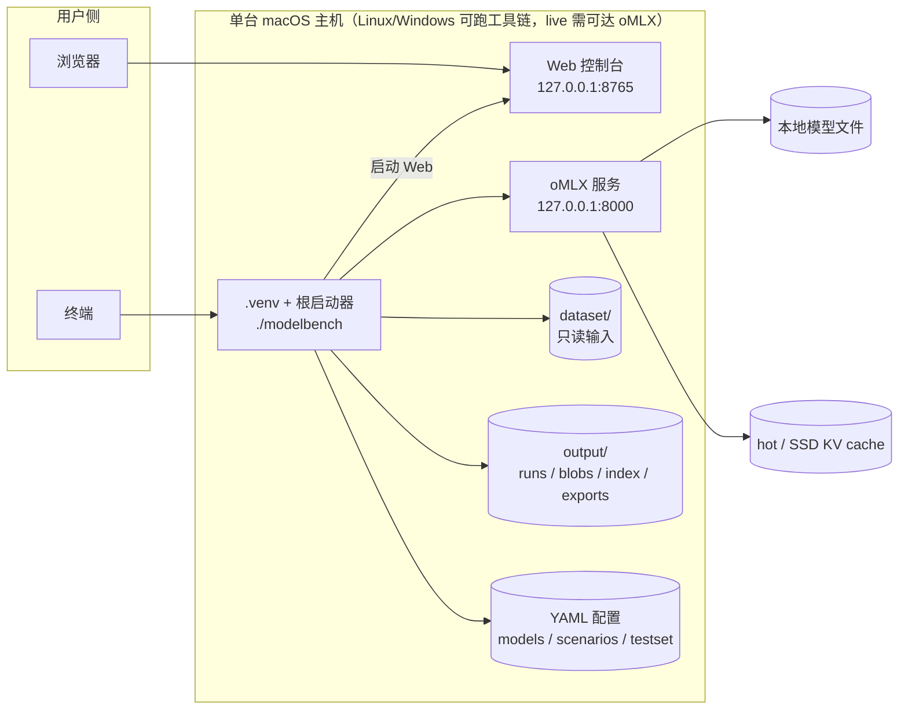

**部署单元**

| 单元 | 形态 | 生命周期 | 说明 |
|---|---|---|---|
| Web 控制台 | 本仓库 Python 进程 | `./modelbench web` 启动；`Ctrl+C`/idle 退出 | 仅回环；无鉴权；非 benchmark 常驻 |
| CLI | 本仓库 Python 进程 | 命令级 | 同步执行；退出即结束 |
| oMLX | 独立 macOS 应用/服务 | 用户启动/停止 | 本系统不安装、不重启、不杀死 |
| 数据集/配置 | 文件 | 仓库/本地 | `dataset/raw/`、`dataset/.cache/` 只读；测试集 YAML 随仓库 |
| 结果 | 文件 | run 级 | `output/`，gitignore；可作为证据归档 |

### 6.2 端口、协议与认证

| 边界 | 地址/端口 | 协议 | 认证 | 可配置项 |
|---|---|---|---|---|
| 浏览器 → Web | `127.0.0.1:8765`（默认） | HTTP/JSON | 无（仅本机） | `--host`、`--port`；非回环需 `--allow-external` |
| Web/CLI → oMLX 推理 | `server.base_url`，默认 `http://127.0.0.1:8000` | HTTP/JSON + SSE | `Authorization: Bearer` + `X-API-Key` | `server.api_key` / `OMLX_API_KEY` / oMLX 本地设置 |
| Web/CLI → oMLX 管理 | 同 base_url | HTTP/JSON | `/admin/api/login` 建立 admin 会话；未单独配置 admin key 时回退主 API key | `server.admin_api_key` / `OMLX_ADMIN_API_KEY` |
| Web/CLI → 文件系统 | 本地路径 | POSIX/Windows 文件 API | 操作系统权限 | `run.output_dir`、`datasets.*` |
| 服务端 PID 发现 | 本地 | `lsof` / pid file | 本机 | `server.pid_file` |

**超时**：推理请求默认 `request_timeout_s=900`、连接 `connect_timeout_s=10`；模型加载等待
600s、卸载等待 120s；Web 样本预览子进程 300s。

### 6.3 文件系统布局与读写归属

```text
<clone>/
  .venv/                         # setup 创建；不提交、不跨机器复制
  src/modelbench/                # 源码（包布局见 33-project-structure.md）
  harness/                       # 门禁/任务板/门禁报告（reports/ 生成）
  reports/                       # 评审/审计/实验记录（**非证据**，索引见 reports/README.md）
  tool/                          # 数据集构建/校验、下载、bootstrap（运行时可选）
  test/                          # 测试契约
  dataset/
    raw/                         # 上游原始文件：只读，不提交
    .cache/                      # tokenizer/索引缓存：只读/可重建，不提交
    processed/                   # 历史/兼容归一化缓存：可重建，不提交
    test/<name>/testset.yaml     # 测试集定义：随仓库提交
    test/<name>/*.jsonl          # 预构造样本：生成物，不提交
  output/
    runs/<run_id>/                       # 每模型 run bundle（一层平铺，目录名 == run_id）
    batches/<batch_id>.json              # 批次权威元数据（一次测试动作一个文件）
    blobs/prompts/<sha[:2]>/<sha>.json   # prompt 内容寻址池（全局一份）
    exports/<batch_id>.xlsx              # 按需 Excel 交付物
    archive/                             # 退役 run/旧格式（GC 引用根）
    index.json                           # run 目录索引（派生）
    .state/index.lock                    # 索引写锁
    .state/benchmark.lock                # 同 output 根跨进程锁
```

| 路径 | 读/写 | 是否提交 | 说明 |
|---|---|---|---|
| `dataset/raw/` | 只读（运行时） | 否 | 数据问题走 `tool/dataset` 重建，需人类确认 |
| `dataset/test/**/testset.yaml` | 读 | 是 | 测试集契约 |
| `dataset/test/**/*.jsonl` | 读 | 否 | 预构造/自定义样本 |
| `output/` | 写 | 否 | 运行证据；布局/归档/GC 策略见 [31-output-contract.md](31-output-contract.md) |
| `harness/reports/` | 写 | 否 | 门禁报告 |
| `reports/`（根目录） | 写 | 否（gitignored） | 评审/审计/一次性分析记录，**不是测试证据**；索引与保留策略见 `reports/README.md`（gitignored 本地文件），长期结论应进 `docs/`/`docs/records/` |
| `.venv/`、`.uv-cache/` | 写 | 否 | 环境/缓存；不跨机器复制 |

### 6.4 安装、启动与停止

| 操作 | macOS/Linux | Windows | 说明 |
|---|---|---|---|
| 建环境 | `./modelbench setup` | `modelbench.cmd setup` / `modelbench.ps1 setup` | 创建/修复 `.venv`，安装 `.[dev]` |
| 离线自检 | `./modelbench validate --offline` | 同上 | 不联系 oMLX |
| 启动控制台 | `./modelbench web` | 同上 | 默认打开浏览器；`--no-open` 关闭 |
| CLI 测试 | `./modelbench run` | 同上 | 需 oMLX 可达与 API key |
| 停止控制台 | `Ctrl+C` | `Ctrl+C` | 或 `--idle-timeout` 自动退出；不停止 oMLX |
| 停止运行中 job | Web“取消”或 `POST /api/jobs/<id>/cancel` | 同左 | 协作取消；CLI 用 `Ctrl+C` |
| 重建结构文档 | `make docs-write` | `.venv\Scripts\python.exe -m harness.gen_structure --write` | 目录变化后必须 |

**平台边界**：oMLX 桌面应用目前仅 macOS；Windows/Linux 可离线 validate、构建数据集、启动 Web、
阅读结果；live 测试需把 `server.base_url` 指向一台可达的 oMLX 实例。

### 6.5 安全边界

1. **网络面最小**：Web 默认只绑定回环；`--allow-external` 是显式危险开关（控制台无鉴权），
   不应暴露到不可信网络。
2. **凭据**：API key 按“显式配置 → 环境变量 → 本地 oMLX 设置”解析；`run.json` 只写脱敏配置；
   门禁 `secrets` 扫描跟踪文本中的凭据字面量。
3. **管理 API**：admin key 只用于缓存/设置；会话只在进程内；不写入结果。
4. **本地文件读取**：`/api/runs/<id>/file` 经 `resolve_run_file()` 规范化并限制在 run 目录；
   `static` 路径同样做前缀校验。
5. **输出即敏感数据**：`blobs/prompts/` 含 prompt 原文、`records.jsonl` 含 response 原文，按私有数据管理；
   不提交 git、不默认上传。
6. **Excel 注入**：模型输出/数据集文本写入 Excel 前去除非法控制字符，并对 `= + - @` 前缀
   加 `'`，避免公式注入。
7. **无隐式外联**：运行时不访问云；`upload_projection` 只是本地投影，不执行上传；
   下载由显式 `./modelbench download`/数据集工具触发。
8. **写端点 Origin/Host 防护**：所有 `POST`（`/api/estimate`、`/api/run`、`/api/models/sync`、
   `/api/jobs/<id>/cancel`、`/api/runs/<id>/reveal`、`/api/output/reveal`、
   `/api/testsets/reveal`、`/api/index/rebuild`）在 `do_POST` 最前面执行
   `_reject_cross_site_write`：请求带 `Origin` 时，其 scheme 必须是 `http/https` 且
   **netloc 与 `Host` 完全一致**（含端口），否则返回 **403**；不带 `Origin` 的
   curl/CLI/脚本按设计放行（本地工具场景）。这是**浏览器跨站写防护**，不是鉴权。

**威胁模型（本地 Web 控制台）**

| 资产 | 威胁 | 当前现状 | 缓解/建议 |
|---|---|---|---|
| 主机 CPU/内存/模型 | 本机其他用户或浏览器跨站 POST 触发 `/api/run` | 无鉴权；写端点已校验 Origin/Host | 浏览器跨站写 → 403；无 Origin 客户端按设计放行；多用户机器不要运行 |
| `models.yaml`（git 跟踪） | 跨站 `POST /api/models/sync {apply:true}` 改写清单 | 无鉴权；写端点已校验 Origin/Host | 跨站写 → 403；同源/无 Origin 仍可写，运行中已 409 |
| 运行结果/本机 UI | 跨站调用 `reveal`、`cancel` 产生本机副作用 | 无鉴权；写端点已校验 Origin/Host | 跨站写 → 403；仍建议仅在单人本机使用 |
| 服务暴露面 | `--allow-external` 把无鉴权控制台暴露到网络 | 仅提示风险 | 默认禁止；如必须暴露，前置反向代理+认证 |
| 结果私密性 | `blobs/prompts/` 与 `records.jsonl` 含 prompt/response 原文 | 文件权限即边界 | 不提交 git、不共享输出目录；归档前脱敏 |

> **边界说明**：Origin/Host 校验只阻止"浏览器里的第三方页面"发起写请求；它**不是鉴权**
> ——本机进程/无 Origin 客户端仍可直接调用，且 `Host` 头可被非浏览器伪造。控制台默认只绑
> 回环，**不要**用 `--allow-external` 暴露到不可信网络；需要远程访问时自行加认证和 TLS。

### 6.6 容量与性能特征

| 项 | 量级/行为 |
|---|---|
| 默认性能测试集 | 240 条 / 约 13 MB；流式解析，只保留选中样本对象（不常驻原始 JSONL dict） |
| 默认计划 | 每模型 8 场景 × 3 档 = 24 cells、240 measured 请求；长上下文会显著拉长耗时 |
| 大模型/长上下文 | 32K 预填充慢；默认全量 run 可能数小时；小样本冒烟更快 |
| 32K 桶可测性 | 32K target 固定 **32,768**（无特判）；构建验收边界与逐数字推导见 [11-performance-testset.md](../spec/11-performance-testset.md) §4.5（单一事实源）；**不是运行时门槛**——运行期只按目标模型 actual + max_tokens + 128 判定窗口 |
| 输出体积 | prompt 正文全库一份（`blobs/prompts/`）；单 run 仅元数据+瘦记录+派生表（约 1 MB 量级，随样本数增长）；`exports/` 按需 |
| Web 样本浏览 | 按需加载 + 进程内缓存；原始数据 ≥200MB 时用子进程解析，避免常驻内存；单页 ≤1000 |
| 并发 | 设计为串行；不测并发吞吐；同一 oMLX 实例（任意 output 根）同时只允许一个 run（双锁）；不同 `base_url` 可并发 |
| 采样开销 | 50ms 一次进程树采样；会记录采样窗口与样本数，但对推理的干扰未做量化标定 |

---

## 7. 横切关注点

### 7.1 可复现性与证据链

**图 7-1 可复现性与证据链**

```mermaid
flowchart LR
  CFG["配置快照<br/>run.json.config"] --> RUN["run"]
  HW["硬件/OS/oMLX<br/>run.json.env（唯一快照）"] --> RUN
  DS["测试集 + 样本选择<br/>batches/<batch_id>.json inputs.testset + sample_ids"] --> RUN
  INV["实际发送的 prompt<br/>blobs/prompts/<sha256>"] --> REC
  RUN --> REC["records.jsonl<br/>逐请求权威证据"]
  RUN --> SUM["aggregates.json / samples.csv / report.md"]
  RUN --> LOG["logs/run.log"]
  RUN --> MAN["MANIFEST.json<br/>path/bytes/sha256"]
  REC --> AGG["overall + cells + 逐样本表"]
  MAN --> IDX["output/index.json"]
```

**可复现条件（当前实现）**：同配置快照、同测试集/抽样、同模型默认设置 + 冷缓存；`temperature`
在 `RequestSpec` 中固定为 0.0，`run.seed` 默认 `null`（表示不固定随机种子）；模型 id/量化/
engine 在 `run.json.env` 中。**输入自证**：`batches/<batch_id>.json` 的
`inputs.testset.sha256/rows` 记录测试集指纹，`blobs/prompts/` 保存实际发送的完整 messages
（内容寻址、可自校验），`records.jsonl` 另存目标模型 tokenize 的
`request.tokenized_prompt_tokens` 与 `context_meta.isl_tolerance`（actual 记录与 ±10% 入带
判定；actual 不触发跳过）。**固定样本可移植**：同一 testset/SHA 可交付其他机器/系统执行，
准入条件见 [../spec/13-testset-portability.md](../spec/13-testset-portability.md)。
**剩余缺口**：上游 `dataset/raw` 的内容 hash 未进 bundle（数据重建后仍需人工判断是否同源）；
`repeats=1` 时没有 run-to-run 噪声基线。缺少上述任一项，结果只能作为“该次运行”的证据，
不能横向比较。

### 7.2 可观测性

| 通道 | 内容 | 消费者 |
|---|---|---|
| `stderr` | 实时进度/警告（`_log`） | 终端用户 |
| `logs/run.log` | 同 stderr 的持久化 | Web 日志尾、排障 |
| `run.json.outcome.skipped/warnings` | 跳过/降级原因（每条带位置与原因） | 用户、审计、验证者 |
| `Job.snapshot()` | 模型/cell/样本进度、当前记录 | Web 前端 |
| `harness/reports/*.json` | 门禁结果 | CI/维护者 |
| `output/index.json` | 目录索引 | Web/CLI/分析 |

没有引入 Prometheus/日志平台：这是单机工具，文件 + 结构化字段足够。

### 7.3 安全与隐私

安全边界、威胁模型与缓解措施见 §6.5；本节只补充横切原则：

- **默认最小暴露**：仅回环；外部访问是显式、危险的选项。
- **凭据不落盘**：配置快照脱敏；oMLX 全局设置按白名单投影；不打印 key。
- **结果私有**：prompt/response 原文可能含用户数据；`output/` 不入库、不上传。
- **信任边界**：数据集/模型输出视为不可信文本；Excel 写入做清洗；Web 文件读取做路径校验。

### 7.4 错误处理与不静默降级

统一模式：

1. **可重试**：传输错误/超时（预算内退避）；冷缓存污染（独立预算）。
2. **不重试**：内存守卫、工具 schema；直接记录并继续/中止。其余异常（含协议 4xx）当前仍走
   传输重试预算，这是已知偏差（见 §4.5、§8.2）。
3. **可降级**：环境快照失败、Excel 失败、optional 设置失败 → warning；测量继续，但结果需复核。
4. **fail-closed**：缓存清理失败、冷缓存污染耗尽 → 不进聚合/中止 cell。
5. **显式跳过**：所有未测样本/模型写 `skipped`，并带原因。

### 7.5 兼容性与迁移

- **schema**：bundle `3.0`、索引 `2.0`；2.x bundle 不兼容，已归档到 `output/archive/legacy-v2/`，
  不参与索引也不做跨版本平均。
- **一次性迁移（`tool/migrate/legacy_v2_to_v3.py`）**：新迁移写出的 `records.jsonl` 每条
  `schema_version="3.0"`（prompt 正文外置、环境上提），原 2.x 版本保存在
  `sample_meta.migrated_from_schema`（如 `"2.1"`）；**已迁移的历史 8 个 run 的 records 仍是
  2.1 旧件**（当时未写 3.0，保留不改写）——读取时需按"新迁移件=3.0 / 旧迁移件=2.1 legacy"区分，
  `verify`/索引只要求 bundle 目录为 3.0 布局，不强制每条记录字段版本。
- **平台**：macOS 为 live 主平台；Linux/Windows 支持工具链/离线；路径解析集中，避免硬编码。
- **oMLX 版本**：settings 白名单/`feature_flags` 随版本漂移；升级后需重新校验
  `UPLOADED_SETTING_FIELDS` 与 `FEATURE_FLAG_TOGGLES`，见 §9。
- **Python**：`>=3.10`；依赖上限见 `pyproject.toml`。

---

## 8. 视图一致性与已知偏差

### 8.1 跨视图结论

逐项校验见 §2.11，本节不再重复矩阵。当前仅剩一项跨视图不一致需要处理：

1. **UC-02 后端能力缺口（结构契约已缓解，能力面仍 P1）**：`AppBackend` 的**结构契约**已
   可执行（`REQUIRED_BACKEND_METHODS` + `backend_contract_errors()` + `test_core` 全方法
   测试）；但 Orchestrator 仍直接调用端口外的
   `models_status/loaded_models/model_config/discover_server_pid`，按 §5.5 直接注入仍会失败
   （P1，后端扩展阻塞；T-004）。
   （原 UC-07 锁作用域缺口已由 ADR-03 双锁闭环，回归判据见 V&V V-5。）

其余 P1 风险（Web 无鉴权、非协作中断、数据 hash、重复性噪声）见 §8.2。

### 8.2 已知偏差与风险

| 偏差/风险 | 影响 | 现状/计划 |
|---|---|---|
| Orchestrator 直接依赖 `OMLXClient` | 新后端无法零改动接入 | P1；见 §9、T-004 |
| 旧 bundle 不能直接读取 | 旧结果需旧版工具打开或一次性重序列化 | P1；T-003 |
| oMLX settings 白名单可能漂移 | 环境快照漏字段/误报 feature flags | P1；升级时维护 allowlist |
| `OMLXBackend` 以继承而非组合实现 | 端口契约执行不严格 | P1；结构契约已由 `REQUIRED_BACKEND_METHODS`/`backend_contract_errors()` + `test_core` 守护，剩余是组装方式（与 backend 解耦一起处理） |
| 无并发吞吐测量 | 不能回答“多并发下性能” | P2；设计上串行 |
| Web 控制台无鉴权 | 不能暴露到不可信网络 | 设计约束；`--allow-external` 显式风险 |
| 单 output 根串行 | 同一 `base_url` 的多个环境不能并发（设计约束） | oMLX 全局状态决定；不同 `base_url` 可并发 |
| 判分器保留但未接入 | 结果无准确率 | 有意为之；恢复需独立模式与口径 |
| 长 run 无随机化/热漂移检测 | 长时间运行可能受系统漂移影响 | P1/P2；默认 `repeats=1` 无噪声基线；见 TEST_PLAN 风险 |
| ~~跨 output 根并发同一 oMLX~~ | 已修复：endpoint 锁按 `base_url` 互斥（ADR-03） | **P0→已闭环**；回归用例见 V&V V-5（保留该行作为回归提醒） |
| **AppBackend 结构契约已可执行，能力缺口仍在** | 新后端仅实现端口方法会在 `models_status` 等处 AttributeError | 结构契约：`REQUIRED_BACKEND_METHODS` + `backend_contract_errors()` + `test_core` 全方法测试（**P1 已缓解**）；能力缺口（Orchestrator 直接依赖 `OMLXClient` 并调用端口外方法）仍为 P1/T-004 |
| ~~Web 无 `Origin`/`Host` 防护~~ | 浏览器跨站可触发 run/sync/reveal | **P1→已缓解**：所有 POST 经 `_reject_cross_site_write`（Origin 与 Host 不一致 → 403；无 Origin 的 CLI/脚本放行）；仍**无鉴权**，勿用 `--allow-external` 暴露 |
| 非协作中断/孤儿 bundle | 崩溃后可能缺 `MANIFEST.json`/索引项，`verify` 可检出 | P1；`rebuild` 可恢复派生文件；job 持久化/自动清理待建 |
| bundle 缺上游数据集内容 hash | 测试集指纹已在 `batches/<batch_id>.json` 的 `inputs.testset`，但 `dataset/raw` 内容 hash 未进 bundle | P1；可复用 dataset_integrity 的 SHA-256 |
| 输出体积无配额 | 已有 `gc`/`rebuild`/`pack`/`archive`，但没有体积配额与 `retention.pinned` 强制 | P2；见 [31-output-contract.md](31-output-contract.md) §7 |
| Web/CLI 配置装配重复 | 新参数可能只改一边 | P2；抽到 application 共用 |
| `docs_contract` 只校验机械项 | prompts/docs 子目录/旧产物名已纳入，但数字/语义仍靠审查 | P2；已加 facts/数字校验为后续增强 |
| 与用户/其他工具共用 oMLX | `isolate_models` 会驱逐他人模型，cold 清理清全局 cache | P1 运维风险；需在文档/UI 明示“独占使用”假设 |

---

## 9. 技术债与演进

| 优先级 | 事项 | 说明 | 关联 |
|---|---|---|---|
| P1 | 拆分 Orchestrator | 生命周期 / agentic / 记录生成三个模块，降低单文件复杂度 | T-002 |
| P1 | 旧 bundle 转换工具 | 一次性把 2.x bundle 重序列化为 3.0（归档原件保留；不在运行时链路） | T-003 |
| P1 | 后端完全解耦 | 补端口能力（`models_status/loaded_models/model_config/discover_server_pid`）、runner 注入 `AppBackend`、fake backend 验收用例 | T-004 |
| P1 | 环境字段对齐 | 跟随 oMLX 版本维护 settings 白名单与 feature flags | — |
| P1 | 缓存证据入记录 | 清理返回摘要/cache-store 头可审计 | T-005 |
| P1 | 发布与版本管理 | CI（`.github/workflows/ci.yml` + `gate --ci`）已存在；剩余：版本号规则、CHANGELOG、发布清单 | T-007 |
| P2 | 报告可视化 | 静态 HTML：TTFT-上下文曲线、模型对比、误差棒 | T-008 |
| P2 | 并发/吞吐 | 串行测量不覆盖并发服务能力；需独立模式 | — |
| P2 | 长上下文扩量 | LongBench-v2 全量 + 多文档/RULER 类构造 | T-006 |
| P2 | Agent 工具执行器 | 安全只读工具 + 轨迹审计 | T-009 |
| P2 | 运行漂移检测 | 长 run 的随机化/交错/热漂移检测 | TEST_PLAN |
| P1 | Web 安全加固 | Host/Origin 校验、写端点自定义 header/token、`--allow-external` 强制认证 | 新增任务 |
| P1 | Job 持久化与孤儿清理 | `output/jobs.json` 保存 job；启动时检测缺 `MANIFEST.json` 的孤儿 run（`verify` 已可检出） | 新增任务 |
| P1 | 数据集 hash | 在批次元数据 `inputs` 记录上游 `dataset/raw` 内容 SHA-256（测试集指纹已有） | 新增任务 |
| P2 | 输出保留策略 | 已有 `archive/`+`gc`+`rebuild`+`pack`；剩余：体积配额、`retention.pinned` 强制、自动清理 | 新增任务 |
| P2 | 配置装配共用 | Web/CLI `build_config` 抽到 application，避免漂移 | 新增任务 |

**演进原则**：先保持测量语义稳定，再扩展能力；任何改变缓存/指标/schema/样本选择的变更，
必须先更新 [20-methodology.md](../spec/20-methodology.md)/[21-test-plan.md](../spec/21-test-plan.md)，再改代码与本文。

---

## 10. 附录

### 10.1 Run bundle 文件清单

布局唯一实现在 `src/modelbench/adapters/storage/layout.py`；完整规范与使用方式见
[31-output-contract.md](31-output-contract.md)。

| 路径 | 内容 | 权威性 |
|---|---|---|
| `output/batches/<batch_id>.json` | 批次元数据（来源/方法/模型清单/输入指纹/retention） | 批次权威（唯一副本） |
| `output/runs/<run_id>/run.json` | run 元数据 + 配置 + **唯一**环境快照（含 `env.server_models`）+ `outcome` 对账计数 | 权威（环境证据只此一份） |
| `output/runs/<run_id>/MANIFEST.json` | 同目录文件清单（path/bytes/sha256）+ blob 引用统计（`bytes` 本 run 引用、`pool_bytes` 全库池） | 权威（完整性） |
| `output/runs/<run_id>/records.jsonl` | 每条请求一条记录（身份/输入指纹/响应/指标/缓存/模型快照引用） | **逐请求权威证据** |
| `output/runs/<run_id>/samples.csv` | 逐样本主表（36 列，含 `cache_*`、`isl_band`、`prompt_sha256`） | 派生（可重建） |
| `output/runs/<run_id>/aggregates.json` | `overall`（每 model×档位）+ `cells`（每 model×scenario×dataset×档位） | 派生（可重建） |
| `output/runs/<run_id>/report.md` | 人读摘要（配置/环境/整体/数据集/逐样本） | 派生（可重建） |
| `output/runs/<run_id>/logs/run.log` | 运行日志 | 运维 |
| `blobs/prompts/<sha[:2]>/<sha>.json` | 实际发送的完整 messages（内容寻址、全库一份） | 权威（不可再生） |
| `output/index.json` | 全量 run 目录索引（索引 schema 2.0，只存相对路径） | 派生（可重建） |
| `output/exports/<batch_id>.xlsx` | Excel 交付物（硬件/均值/明细三页签） | 派生（按需生成） |
| `output/archive/` | 退役 run/旧格式 bundle | 归档证据（GC 引用根） |
| `output/.state/{index.lock,benchmark.lock,tmp/}` | 索引写锁、跨进程运行锁、临时物 | 协调文件（非证据） |

### 10.2 关键代码索引

| 主题 | 代码位置 |
|---|---|
| 编排/测量/缓存/取消 | `src/modelbench/application/benchmark.py` |
| 批处理/锁/Excel/批次 | `src/modelbench/application/batch.py` |
| 计划/测试集应用 | `src/modelbench/application/plan.py` |
| 跨进程锁 | `src/modelbench/application/locking.py` |
| Web 样本预览子进程 | `src/modelbench/interfaces/web/sample_worker.py` |
| 端口协议 | `src/modelbench/application/ports.py` |
| oMLX HTTP/SSE/时序 | `src/modelbench/adapters/omlx/client.py` |
| 缓存治理 | `src/modelbench/adapters/omlx/cache.py` |
| 环境/设置快照 | `src/modelbench/adapters/omlx/environment.py` |
| Web API/Job | `src/modelbench/interfaces/web/server.py`、`src/modelbench/interfaces/web/jobs.py` |
| 输出布局（唯一路径来源） | `src/modelbench/adapters/storage/layout.py` |
| prompt 内容寻址池 | `src/modelbench/adapters/storage/blobstore.py` |
| run 写入（7 个产物的落盘时序） | `src/modelbench/adapters/storage/writer.py` |
| 目录索引（index.json 2.0） | `src/modelbench/adapters/storage/catalog.py` |
| rebuild/verify/gc/pack 派生工具 | `src/modelbench/adapters/storage/tools.py` |
| Excel 交付物（按需导出） | `src/modelbench/adapters/storage/excel_report.py` |
| 领域模型/指标 | `src/modelbench/domain/models.py`、`src/modelbench/domain/metrics.py` |
| 配置/模型清单 | `src/modelbench/adapters/config/settings.py`、`src/modelbench/adapters/config/testsets.py` |
| 硬件/资源采样 | `src/modelbench/adapters/host/hardware.py`、`src/modelbench/adapters/host/sampler.py` |
| 门禁/文档契约 | `harness/gate.py`、`harness/docs_contract.py` |

### 10.3 本文维护清单

改以下内容时同步更新本文并跑 `make docs`：

1. 目录/模块/分层或依赖方向（§3、§5.1）；
2. 新增/修改 oMLX 或 Web API、状态码、认证（§2.10、§6.2）；
3. 模型生命周期、缓存/重试/取消语义（§2.4、§2.5、§4）；
4. 配置项、默认值、测试集/样本口径（§3.6、§1.4）；
5. 产物布局、索引、Excel（§10.1、RESULTS）；
6. 平台/安装/端口/安全边界（§6）；
7. 技术债状态（§9）。

**评审清单**：关键 API 顺序是否与代码一致？图是否覆盖失败/取消路径？视图间是否有矛盾？
数字（240/24/8/11）是否与测试集和注册表一致？文档契约是否 PASS？
