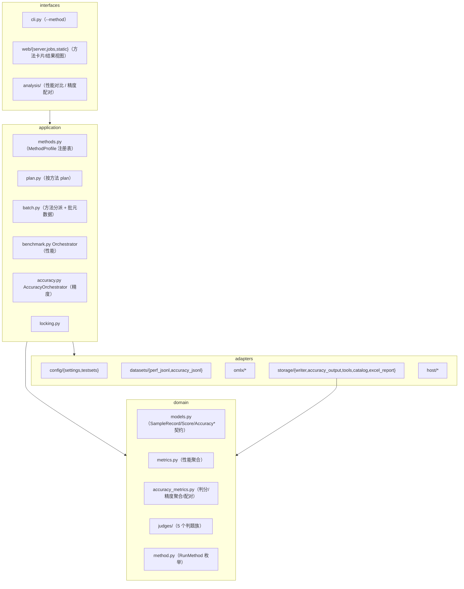
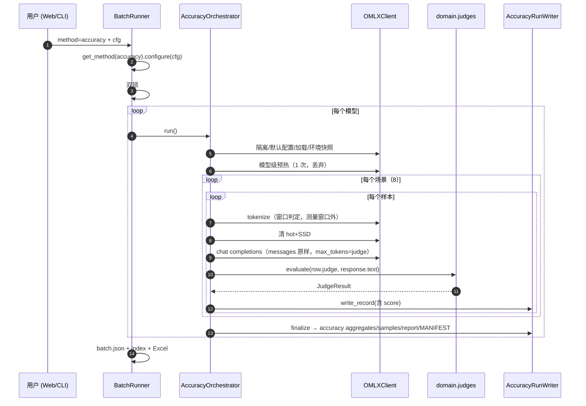

# 双测试方法架构与实现设计（METHOD ARCHITECTURE）

> **状态**：current ｜ **版本**：v1.0（2026-11-11）｜
> **范围**：`method=performance`（既有）与 `method=accuracy`（新增）如何在同一套测量内核上
> **并存、分派、产出可区分的结果**；面向维护者、评审者与 AI Agent。
>
> 配套契约：[22-accuracy-test-plan.md](../spec/22-accuracy-test-plan.md)（精度方案）、
> [21-test-plan.md](../spec/21-test-plan.md)（性能方案）、[20-methodology.md](../spec/20-methodology.md)
> （性能指标）、[31-output-contract.md](31-output-contract.md)（产物）、
> [30-architecture.md](30-architecture.md)（4+1 视图与硬约束）。

---

## 1. 设计目标

1. **一套测量内核，两种测试方法**：oMLX 驱动、模型生命周期、冷缓存、资源采样、双锁、单实例串行、
   环境快照、逐样本证据、bundle 布局全部复用，避免复制两套 runner。
2. **方法差异显式化**：输入构造、判题、聚合、报告、结果视图、默认参数由 `MethodProfile`
   声明；禁止在 runner/Web 里散落 `if method == ...`（只在组合根与展示层做分派）。
3. **产物可区分、可复算**：`run.json.method` / `run_id.__<method>__` / `aggregates` 形状 /
   `samples.csv` 列 / 报告标题共同标识方法；`verify`、`rebuild`、`analyze`、Web、Excel 按方法工作。
4. **对外清晰**：Web 首屏用两张方法卡片选择"性能测试 / 精度测试"，卡片切换测试集、参数面板、
   结果视图与说明；两种方法不共享同一个参数表单。
5. **不回归性能**：性能路径的行为、口径、测试、AC-1…AC-11 保持不变；所有改动是**加法 + 钩子**。

非目标：抽象掉 oMLX 后端（T-004 技术债）；支持第三种方法（预留注册表）；把精度/性能分数合成
综合分；重写既有 `Orchestrator`。

---

## 2. 共用 vs 区分（决策表）

| 关注点 | 共用（kernel） | 区分（method） | 理由 |
|---|---|---|---|
| oMLX HTTP / SSE / 管理 API | ✅ `adapters/omlx/*` | — | 与测量目的无关 |
| 模型生命周期、默认配置复位、MoE 设置 | ✅ `Orchestrator._ensure_model_ready` | — | 两方法都必须"默认配置 + 已加载" |
| 冷缓存治理、污染判定 | ✅ `adapters/omlx/cache.py` | 精度强制 `cold` | 精度要求确定性 |
| 资源采样、环境快照、git/硬件 | ✅ `adapters/host/*`、`environment.py` | — | 证据链一致 |
| 双锁、批内串行 | ✅ `application/locking.py`、`BatchRunner` | — | 同一 oMLX 实例全局状态 |
| 逐样本记录 / prompt 内容寻址 / MANIFEST | ✅ `RunWriter.write_record`、blobstore | — | 审计与去重共用 |
| 目录/索引/batch 布局 | ✅ `layout.py`、`catalog.py` | `run_id` 方法段、index `mode` | 平铺布局不变 |
| 数据集读取 | `DatasetAdapter` 接口 | `perf_jsonl` vs `accuracy_jsonl` | 行 schema 不同 |
| 请求构造 | 单请求执行/重试 | `RequestSpec`：统一 OSL/guard vs 逐行 judge 长度、无 guard | 测的东西不同 |
| 缓存模式默认 | 默认值 | 精度固定 cold、repeats=1、retries=1 | 协议不同 |
| 判题 | — | 精度：5 族确定性判题；性能：`score=null` | 方法定义 |
| 聚合 | 逐记录复算原则 | `domain/metrics.py` vs `domain/accuracy_metrics.py` | 指标不同 |
| 产物形状 | bundle 文件集合 | `aggregates.json`/`samples.csv`/`report.md` 内容 | 阅读者不同 |
| CLI | `run` 公共参数 | `--method`、方法专属参数 | 显式选择 |
| Web | 模型/测试集/运行/取消/结果外壳 | 方法卡片、参数面板、结果标签页 | 对外呈现 |
| 分析 | run 解析/批处理 | `analyze`：性能对比 vs 精度配对 Δ | 结论不同 |

**一句话**：`method` 只影响**"测什么 + 怎么判 + 怎么汇总/展示"**，不影响**"怎么安全地驱动
oMLX 并留下证据"**。

---

## 3. 逻辑视图：分层与模块



### 3.1 模块职责

| 模块 | 新增/修改 | 职责 |
|---|---|---|
| `domain/method.py` | 新增 | `RunMethod`（`performance`/`accuracy`）字符串枚举 |
| `domain/models.py` | 修改 | `AccuracyCellAggregate`/`AccuracyOverallAggregate`/`AccuracySlice`/`AccuracySampleResult`；`RecordStatus.JUDGE_ERROR`；`Score` 复用 |
| `domain/judges/` | 新增（自 `tool/system/judges.py` 迁移） | 5 个判题族 + `evaluate(row, response)` + 依赖探测；`tool/system/judges.py` 变转发 |
| `domain/accuracy_metrics.py` | 新增 | 判分归一化、精度 cells/overall、Wilson/normal CI、宏平均、配对统计（McNemar/Holm/bootstrap） |
| `adapters/datasets/accuracy_jsonl.py` | 新增 | 读 `testset.jsonl` 场景切片；`Sample.metadata` 携带 `judge/language/upstream/meta`；`plan()` 返回场景切片样本数 |
| `adapters/config/settings.py` | 修改 | `RunMethod` 字段、`AccuracyConfig`、方法默认值应用 |
| `adapters/config/testsets.py` | 修改 | `TestSet.method`（默认 performance）；`apply_testset` 设置 `cfg.method` |
| `application/methods.py` | 新增 | `MethodProfile` 协议 + `PERFORMANCE` / `ACCURACY` 注册表：orchestrator/writer/plan/fingerprint/默认参数/UI 元数据 |
| `application/plan.py` | 修改 | `plan_overview` 按方法分派；精度 plan 为 `scenario -> n samples`（无 bucket） |
| `application/benchmark.py` | 修改（钩子） | 抽出可覆写点：`method_name`、`_scenario_for`、`_plan_log_fields`、`_select_samples`、`_group_samples`、`_build_request`、`_postprocess`、`_sample_meta`、`_apply_decode_guard`、`_finalize_extra` |
| `application/accuracy.py` | 新增 | `AccuracyOrchestrator(Orchestrator)`：精度请求/窗口/判分/日志 |
| `application/batch.py` | 修改 | 用 `MethodProfile` 选择 orchestrator/writer；按方法写 batch 元数据与 testset 指纹 |
| `adapters/storage/accuracy_output.py` | 新增 | 精度 aggregates/samples.csv/report 的纯函数（writer 与 rebuild 共用） |
| `adapters/storage/writer.py` | 修改 | `AccuracyRunWriter(RunWriter)` 覆写 `finalize`（复用 manifest/catalog/close） |
| `adapters/storage/tools.py` | 修改 | `rebuild`/`verify` 按 `run.json.method` 分派精度复算 |
| `adapters/storage/catalog.py` | 修改 | index `mode` = 方法；精度 run 可检索 |
| `adapters/storage/excel_report.py` | 修改 | 批次 Excel 按方法分派；新增精度工作簿（场景得分/逐样本） |
| `interfaces/cli.py` | 修改 | `run --method {performance,accuracy}`；`--samples` 映射到方法配置；`list/validate/analyze` 方法感知 |
| `interfaces/web/jobs.py` | 修改 | `build_config` 读取 `method`；`plan_counts` 方法感知 |
| `interfaces/web/server.py` | 修改 | `/api/overview` 返回 `methods` 元数据；`/api/run`/`/api/estimate` 方法校验；run 详情透传 method |
| `interfaces/web/static/*` | 修改 | 方法卡片、参数面板切换、精度结果标签页与表格 |
| `interfaces/analysis/*` | 修改 | `analyze` 按方法：性能表格 / 精度场景 Δ + McNemar/Holm |
| `resources/config/default.yaml` | 修改 | `method` 默认、`accuracy` 配置块 |
| `dataset/test/accuracy/testset.yaml` | 新增 | 使 accuracy 出现在 CLI/Web 测试集列表 |

---

## 4. 配置与分派契约

### 4.1 配置

```python
class RunMethod(str, Enum):
    PERFORMANCE = "performance"
    ACCURACY = "accuracy"

class AccuracyConfig(BaseModel):
    #: 每场景样本数；None = 全部 250（固定样本，不裁剪）。
    samples_per_scenario: Optional[int] = None
    samples_by_scenario: Dict[str, int] = {}
    sample_ids: Dict[str, List[str]] = {}
    # 判题族合法性由 accuracy_jsonl 读取时校验（只允许 5 族，非法行直接 ValueError）。
    # 运行协议固定：temperature=0/top_p=1/cold/repeats=1/retries=1，不在此暴露。

class ProjectConfig(BaseModel):
    method: RunMethod = RunMethod.PERFORMANCE
    perf: PerfConfig = ...
    accuracy: AccuracyConfig = Field(default_factory=AccuracyConfig)

class ModelSpec(BaseModel):                    # 既有字段见 settings.py
    thinking_disable: Literal["explicit_false", "omit"] = "explicit_false"
```

`ModelSpec.thinking_disable` 声明 `thinking_mode=disabled` 的表达方式：默认发
`chat_template_kwargs.enable_thinking=false`；`omit` 完全不发 chat-template kwargs。
`MiniCPM-V-4.6` 是默认非思考模型，但打包的 mlx_vlm 0.7.10 processor 对
`enable_thinking=False` 有特殊分支：`add_generation_prompt=False` 渲染后只追加
`<|im_start|>assistant\n`，丢掉模板默认的空 `<think></think>` 块，导致模型开放 reasoning、
耗尽 `max_new_tokens`；不传 kwargs 反而走正确的默认 no-think prompt。因此 4.6 必须用
`omit`。实际选择写入每条记录 `request.context_meta.thinking_control`
（`disabled:explicit_false` / `disabled:omit` / `auto` / `enabled`），性能与精度共用该机制。

`TestSet` 增加 `method: RunMethod = RunMethod.PERFORMANCE`；`accuracy/testset.yaml` 显式声明
`method: accuracy`，并把 8 个场景的 `dataset` 指向 `accuracy_jsonl`。`apply_testset(cfg, ts)`：

1. `ts.method` 覆盖 `cfg.method`；若 CLI/Web 显式给了 `--method` 且与 testset 冲突 → `ValueError`
   （不静默改口径）；
2. 应用场景 dataset/params 覆盖；
3. 调用 `MethodProfile.configure(cfg)` 施加方法默认值（精度：cold/repeats=1/max_retries=1；
   性能：不变）并记录到 `run.json.config`。

### 4.2 MethodProfile（application/methods.py）

```python
class MethodProfile:                    # 普通基类；子类覆写类属性与行为方法（非 frozen dataclass）
    name: RunMethod = RunMethod.PERFORMANCE   # run_id / batch.json 的方法段
    title: str = ""                     # "性能测试" / "精度测试"
    default_testset: str = ""           # "performance" / "accuracy"
    description: str = ""
    needs_judges: bool = False          # 精度 True（启动检查判题依赖）
    config_block: str = "perf"          # "perf" / "accuracy"
    params: Tuple[Dict[str, Any], ...] = ()       # Web 参数面板元数据 schema
    _result_views: Tuple[str, ...] = ()           # Web 结果标签页顺序

    def configure(self, cfg: ProjectConfig) -> None: ...          # 施加（并校验）方法固定协议
    def make_orchestrator(self, cfg, client, writer, **kw): ...   # 延迟 import 具体 orchestrator
    def make_writer(self, *args, **kw): ...                        # RunWriter / AccuracyRunWriter
    def plan(self, cfg) -> dict: ...                               # plan_overview_<method>
    def testset_fingerprint(self, cfg) -> dict: ...                # testset SHA/rows/方法附加字段
    def result_views(self) -> list[str]: ...
    def metadata(self) -> dict: ...     # /api/overview 的 methods 卡片（name/title/description/…）

METHODS: Dict[RunMethod, MethodProfile] = {RunMethod.PERFORMANCE: _PerformanceMethod(),
                                          RunMethod.ACCURACY: _AccuracyMethod()}
def get_method(name: str | RunMethod | None) -> MethodProfile   # 未知值 ValueError
def method_metadata() -> list[dict]                              # Web 方法卡片列表
def judge_contract_version(manifest) -> str                      # judges-<sha[:16]>
```

两个 profile 都是 `MethodProfile` 的子类实例（`_PerformanceMethod`/`_AccuracyMethod`），
方法差异由类属性 + 覆写的方法表达，**不是** dataclass 字段；registry 以 Web 卡片顺序保存
（performance 在前，历史默认）。`configure` 对精度会**校验并强制**固定协议：`cache_mode`
非 cold、`repeats>1` 或非法 `AccuracyConfig` 直接 `ValueError`（不静默换口径）。

`BatchRunner` 只在组合根分派：

```python
profile = get_method(cfg.method)
writer = profile.make_writer(...)
orchestrator = profile.make_orchestrator(model_cfg, client, writer, progress_cb=..., cancel_event=...)
```

`run_id` 的方法段使用 `profile.name.value`；`batch.json.method` 相同；`_testset_fingerprint`
按方法读取 `dataset/test/<method>/testset.jsonl`（accuracy 额外记录 `manifest.json` SHA 与
`judge_contract_version`）。

---

## 5. 数据契约

### 5.1 输入：`Sample.metadata`（accuracy_jsonl 归一）

```jsonc
{
  "prebuilt": true,
  "judge": {"family": "mc_letter", "answer": "B", "max_new_tokens": 1536},
  "language": "en",
  "upstream_id": "abstract_algebra/test/4|en",
  "dataset_meta": {"sample_id": "...", "subject": "...", "stratum": "..."},
  "messages": [{"role": "user", "content": "<完整 prompt>"}],
  "input_tokens": 129
}
```

`Sample`：`sample_id=row.id`、`dataset=row.dataset`、`scenario=row.scenario`、
`question=首条 user content`、`context=None`、`choices/answer/tools=None`、
`answer_type` 按判题族映射（`mc_letter`→`MC_LETTER`、`ifeval`→`CONSTRAINTS`、
`code_exec`→`CODE`、`tool_call`→`TOOL_CALL`、`normalized_match` 按 metric →
`NUMERIC`/`EXACT`）、`metadata` 如上、`subtask=None`。**不渲染**：`messages` 原样保存在
`Sample.metadata["messages"]`，由精度请求构造直接使用；适配器流式读取、只保留命中场景的行，
`plan()` 用轻量索引（2,000 条短行）回答"每场景选多少"，不重复扫描 15 MB JSONL。

### 5.2 判题：`domain/judges/`

```python
@dataclass
class JudgeResult:
    score: float           # 0/1 或 F1
    passed: bool           # 0/1 判题族；F1 为 score >= 1.0
    detail: Dict[str, Any] # family/metric/pred/gold/reason/format_failure/judge_error

def evaluate(row: dict, response: str) -> JudgeResult  # 单一入口；异常转 judge_error
def missing_dependencies(families: Iterable[str]) -> List[str]
JUDGE_FAMILIES = ("mc_letter", "ifeval", "normalized_match", "code_exec", "tool_call")
```

`evaluate` 必须**永不把异常抛给 runner**：内部 catch → `JudgeResult(score=0, passed=False,
detail={judge_error: True, reason: "..."})`。`code_exec` 子进程、`ifeval` 官方 checker 保持
`tool/system/judges.py` 的既有语义（迁移时不改判定算法）。

### 5.3 记录：`records.jsonl`

复用 `SampleRecord`；精度填充：

- `score = Score(correct, score, detail)`（非空）；
- `request.max_tokens = judge.max_new_tokens`；`request.temperature=0`、`top_p=1`；
- `request.context_meta = {"judge_family":..., "max_new_tokens":..., "prebuilt": True,
  "tokenize_latency_ms":..., "isl_tolerance": null}`（精度不做 ISL 入带）；
- `sample_meta = {"language":..., "upstream_id":..., "judge": {...}, "dataset_meta": {...}}`；
- 判题失败：`status=judge_error`；错误/超时：`status=error/timeout`、`score=None`。

### 5.4 聚合：`aggregates.json`（精度形状）

```jsonc
{
  "schema_version": "3.0",
  "method": "accuracy",
  "run_id": "...",
  "n_records": 2000, "n_samples": 2000, "n_cells": 8,
  "overall": [{
    "model": "minicpm-v-4.7-1b",
    "method": "accuracy",
    "n_samples": 2000, "n_valid": 1992, "n_ok": 1990,
    "n_error": 6, "n_timeout": 2, "n_judge_error": 2,
    "n_format_failure": 17, "n_missing_score": 0,
    "n_scored": 1992, "n_correct": 1200,
    "macro_score": 0.6123, "micro_score": 0.6030,
    "macro_accuracy": 0.6030,          // 仅 0/1 场景
    "score_ci95_low": 0.59, "score_ci95_high": 0.63,
    "accuracy_ci95_low": 0.58, "accuracy_ci95_high": 0.62,
    "n_scenarios_scored": 8,
    "scenario_scores": {"knowledge_qa": 0.60, "...": 0.0},
    "by_language": {"en": {"...": "AccuracySlice"}, "zh": {"...": "AccuracySlice"}},
    "judge_families": ["mc_letter", "ifeval", "normalized_match", "code_exec", "tool_call"]
  }],
  "cells": [{
    "model": "...", "method": "accuracy",
    "scenario": "knowledge_qa", "dataset": "global_mmlu",
    "n_samples": 250, "n_valid": 250, "n_ok": 249,
    "n_error": 0, "n_timeout": 0, "n_judge_error": 1,
    "n_format_failure": 3, "n_missing_score": 0,
    "n_scored": 250, "n_correct": 128,
    "mean_score": 0.514, "accuracy": 0.514,
    "score_std": 0.50,
    "score_ci95_low": 0.452, "score_ci95_high": 0.576,
    "accuracy_ci95_low": 0.452, "accuracy_ci95_high": 0.576,
    "judge_family": "mc_letter", "metric": "accuracy",
    "by_language": {"en": {"...": "AccuracySlice"}, "zh": {"...": "AccuracySlice"}}
  }]
}
```

- `cells` 的键是 `(model, scenario, dataset)`（**无 `context_length`**）；`overall` 每模型一行；
- `macro_score` 是**场景等权平均**（每场景先聚合自己的数据集再平均）；`micro_score` 是全行平均；
- **计数口径**：`n_valid = n_ok + n_judge_error`（产生了判分尝试的 measured 记录）；
  **`n_scored = n_valid`**——判题失败计 0 分但**仍留在分母**（`n_scored = n_ok - n_judge_error`
  会虚高分数，禁止）；`error`/`timeout` 不进分母、单列；`n_missing_score` 统计 `status=ok` 但
  无 `score` 的契约违约行（计 0、显式暴露）；`n_correct` 只统计归一化分数 == 1.0；
- 0/1 判题用 Wilson CI（`accuracy_ci95_*`），`mean_score` 用正态近似（`score_ci95_*`），
  `n<2` 为 null；
- 所有计数/均值可由 `records.jsonl` 复算（AC-A5）；`n_gen_tps_invalid`/`n_isl_in_band`/
  `n_isl_out_of_band` 不写入精度 outcome（性能口径不适用）。

### 5.5 `samples.csv`（精度列）

`model, model_id, scenario, dataset, language, sample_id, upstream_id, repeat, phase, status,
error, judge_family, judge_metric, score, correct, format_failure, judge_error,
max_new_tokens, completion_tokens, input_context_tokens, actual_prompt_tokens, ttft_ms,
e2e_ms, finish_reason, cache_mode, cache_cleared, cache_polluted, prompt_sha256, timestamp`

`accuracy_output.SAMPLES_CSV_FIELDS_ACCURACY` 为唯一列序（**29 列**，与
`AccuracySampleResult` 字段逐项对齐、顺序一致）；Web 读取器按列名类型化
（`score` float、`correct/format_failure/judge_error` bool）。

### 5.6 `run.json` / `batch.json`

- `run.json.method="accuracy"`；`config.method="accuracy"`；`config.accuracy = AccuracyConfig dump`
  （`samples_per_scenario`/`samples_by_scenario`/`sample_ids`）；
  `config.run = {repeats:1, cache_mode:"cold", max_retries:1, warmup_requests:0, thinking_mode,
  warmup_per_model}`；
  `outcome` 保留通用对账块（`n_selected/n_measured/n_ok/n_records/n_samples/n_cells/skipped/
  warnings/duration_s`），追加 `n_scored/n_correct/n_judge_error/n_format_failure/
  n_scenarios_scored`，并**移除** `n_gen_tps_invalid/n_isl_in_band/n_isl_out_of_band`；
- `batch.json.method="accuracy"`；`inputs.testset = {path, sha256, rows, method, manifest_sha256,
  judge_contract_version}`（行数 2000；SHA 以实际文件为准；`judge_contract_version` =
  `judges-<sha256(manifest.judges)[:16]>`）；
- 批次 Excel：`exports/<batch_id>.xlsx`，精度工作簿含「场景得分」「逐样本判分」「错误统计」三页。

---

## 6. 运行流程（精度）



**精度 orchestrator 的实现方式**：继承 `Orchestrator`，只覆写方法钩子（见 §7），
单请求执行/重试/冷缓存/取消/配额/进度全部复用基类；不复制 `_execute`。

---

## 7. 对既有 Orchestrator 的最小钩子（实现契约）

在 `application/benchmark.py` 增加以下可覆写点（默认行为 = 现状，性能零回归）：

```python
class Orchestrator:
    method_name: str = "performance"

    def _scenario_for(self, name: str, spec: ScenarioSpec):
        """性能：build_scenario(name, spec.params)；精度：AccuracyScenario(name, spec.params)
        （轻量命名场景，不渲染 prompt）。"""
        return build_scenario(name, spec.params)

    def _plan_log_fields(self) -> str:
        """计划日志附加字段。性能：""；精度：samples_per_scenario=…（或 all）。"""
        return ""

    def _select_samples(self, scenario_name: str, samples: List[Sample]) -> List[Sample]:
        """性能：cfg.perf；精度覆写用 cfg.accuracy（分层最大余数，同 plan）。"""
        ...

    def _group_samples(self, samples: List[Sample]):
        """性能：{(dataset, context_length): [...]}；精度覆写 {(scenario, None): [...]}。"""
        ...

    def _apply_decode_guard(self, request: RequestSpec) -> None:
        """性能：追加固定长输出指令；精度不调用它（accuracy 的 _build_request 不追加
        guard，保持被评测回答原样）。"""
        ...

    def _build_request(self, scenario, spec, model_id, sample, server_ctx) -> RequestSpec:
        """性能：现有实现；精度覆写为"原样 messages + 逐行 max_tokens + 窗口判定"。
        精度 request.context_meta 写 prebuilt/judge_family/max_new_tokens/isl_tolerance=None，
        并尽力记录 tokenized_prompt_tokens/tokenize_latency_ms（失败记 tokenize_error + warning，
        回退声明值做窗口判定）。"""
        ...

    def _postprocess(self, *, scenario, sample, stream, error, status):
        """返回 (score, status)。性能：(None, status)；精度：判题并可能置 judge_error。"""
        return None, status

    def _sample_meta(self, scenario, sample, request, trace) -> Dict[str, Any]:
        """性能：现有实现；精度覆写为语言/upstream/judge/dataset_meta 元数据。"""
        ...

    def _finalize_extra(self, extra: Dict[str, Any]) -> Dict[str, Any]:
        """finalize 前的证据补充。性能：原样返回；精度：附 testset 指纹
        （`MethodProfile.testset_fingerprint`）与 judge_dependencies（used/missing/missing_assets）。"""
        return extra
```

`_execute` 内部改动仅三处：调用 `_postprocess`、`record.score=score`、进度/日志按
`score`/`correct` 附加字段（性能恒 null，不影响既有断言）。`_run_model_impl` 中
`build_scenario` 调用改为 `self._scenario_for`；`prepare()` 尾部调用 `_finalize_extra`
所需的证据（精度在此检查判题依赖）；其余不变。

**性能路径回归判据**：`test_integration.py`、`test_perf.py`、`test_batch.py`、
`test_results.py` 全绿；性能 `records[].score` 仍恒为 null；`aggregates` 形状不变。

---

## 8. 输出与二次分析

| 能力 | 性能 | 精度 |
|---|---|---|
| `modelbench rebuild` | 现状 | 由 records 复算精度 aggregates/samples/report（复用 `accuracy_output`） |
| `modelbench verify` | 现状（gen_tps/ISL 等） | 校验判分覆盖/计数/场景分/宏平均可复算；不检查 gen_tps/ISL |
| `modelbench analyze A B` | 按 `(model, context_length)` 对比 | 按 `(scenario, sample_id)` 配对：Δpp、McNemar（0/1）、Holm、F1 差值 CI；样本不齐显式报错 |
| `export-analysis` | 现状 | 精度工作簿（场景得分/逐样本/错误统计） |
| Web 运行详情 | 整体/数据集/逐样本/环境/报告 | 场景得分/语言与数据集/逐样本判分/错误统计/环境/报告 |

`verify`/`rebuild` 按 `run.json.method` 分派；未知方法必须报错，不得按性能口径硬算。

---

## 9. Web/CLI 设计

### 9.1 Web 首屏

```text
┌ 测试方法 ────────────────────────────────┐
│ [性能测试]  多快/内存/TPS                  │  ← 两张卡片（单选，带说明与预计耗时）
│ [精度测试]  答得对不对（8 场景×250）       │
└──────────────────────────────────────────┘
测试集：按方法过滤（性能→performance；精度→accuracy）
运行参数：方法专属面板
  - 性能：每场景样本数 / max_tokens / repeats / cache / 预热 / thinking / 上下文档位
  - 精度：每场景样本数（默认全部）/ 场景多选 / 判题说明 / 预计样本数与耗时
估计：如 "精度：8 场景 × 250 = 2,000 样本/模型；bf16+量化约 6h"
[开始测试]  （精度固定 cold、temperature=0，不展示性能参数）
```

API：`GET /api/overview` 增加 `methods: [{name,title,description,default_testset,params,
result_views}]` 与每个测试集的 `method` 字段；`POST /api/estimate`、`POST /api/run` 接受
`method`（缺省 `performance`，与 testset 冲突 → 400）；`_testset_tree()` 按方法分组返回。

### 9.2 结果视图（`_run_detail.summary.mode` 决定）

| 标签 | 性能 | 精度 |
|---|---|---|
| 整体结果 | overall/cells 性能表 | 场景得分表 + 宏平均 + CI + 计数 |
| 数据集 | cell 性能表 | 按语言/数据集剖面 |
| 逐样本 | TTFT/TPS/内存 | 判分：score/correct/format/judge_error/理由 |
| 错误统计 | — | status/error/judge_error/format_failure/over_window |
| 环境与配置 | 现状 | 现状 + 判题依赖/协议 |
| 报告 | report.md | report.md |

Web 端按 `summary.mode` 切换表头与渲染函数；服务端只做形状透传，不复制业务逻辑。

### 9.3 CLI

```bash
./modelbench run --method accuracy --models minicpm-v-4.7-1b                 # 全量 2,000
./modelbench run --method accuracy --samples 5 --models ...                  # 冒烟 40 条
./modelbench run --method performance --models ...                           # 默认值，保持兼容
./modelbench validate --offline
./modelbench analyze RUN_BF16 RUN_QUANT --method accuracy
```

`--method` 缺省为 `performance`；`--testset` 未显式给时用方法默认测试集；两者冲突 → 非 0 退出
并提示。`--samples` 对精度映射到 `accuracy.samples_per_scenario`（每场景 N）。

---

## 10. 兼容性、迁移与风险

1. **向后兼容**：旧 run（无 method 字段）按 `run.json.method or batch.method or "performance"`
   解析；`TestSet.method` 默认 performance；现有 CLI/Web 不传 method 时行为不变。
2. **schema**：`SCHEMA_VERSION` 保持 `3.0`（加法字段）；新 `Aggregate` 类只用于 accuracy bundle；
   `verify` 以 method 分支解释相同文件名。
3. **数据集（已实现）**：`dataset/test/accuracy/manifest.json` 为 `status=wired` /
   `runner=accuracy` / `hidden=false`，并新增 `dataset/test/accuracy/testset.yaml`
   （`method: accuracy` + 8 场景切片）；`testset.jsonl` 仍 gitignored，由
   `tool/dataset/accuracy/build.py` 构建（manifest 的 `description`/deviations 已随 builder
   同步为 wired 表述；`build.py --check` 校验三个状态字段与 testset.yaml 存在）。
4. **风险**：`code_exec` 子进程不是安全沙箱；可选判题依赖缺失 → judge_error（显式）；
   2,000 样本耗时约 3h/模型（Web 必须提示）；精度/性能不可横比、不可混算。精度执行单元按
   scenario 分组（一个 cell/scenario），聚合仍按 `(model, scenario, dataset)`；执行单元标签
   记为 `accuracy`，不改变聚合口径。
5. **技术债**：`Orchestrator` 仍直接 import adapters（T-004）；方法注册表目前是进程内常量，
   第三种方法需加 profile；Web 参数元数据与 HTML 有少量重复（以 `GET /api/overview` 的 `methods` 字段为准）。

---

## 11. 实施工作包（WBS）

| WP | 内容 | 主要文件 | 依赖 | 状态 |
|---|---|---|---|---|
| WP-1 | 领域/数据/判题/配置基础 | §3.1 中 domain、accuracy_jsonl、config、testset.yaml、manifest | 无 | 已实现 |
| WP-2 | 精度编排 + 方法分派 | methods.py、accuracy.py、benchmark.py 钩子、batch.py、plan.py | WP-1 | 已实现 |
| WP-3 | 精度产物/校验/重建/Excel | accuracy_output.py、writer.py、tools.py、catalog.py、excel_report.py | WP-1 | 已实现 |
| WP-4 | Web/CLI 双方法 | web/*、cli.py | WP-1/2/3 契约 | 已实现 |
| WP-5 | 精度配对分析 | analysis/* | WP-1/3 | 已实现 |
| WP-6 | 文档与契约同步 | docs/**、AGENTS、README、CHANGELOG | WP-1…5 | 本次任务（T-075） |
| WP-7 | 独立验证 | harness.gate、fake-server e2e、bundle 复算 | WP-1…6 | 待验证者（T-076） |

**实现状态（2026-11-11）**：WP-1…WP-5 代码已完成；自动化证据见
`test/test_accuracy_run.py`（fake-server e2e）、`test/test_accuracy_metrics.py`（聚合/复算/
配对）、`test/test_accuracy_adapter.py`、`test/test_accuracy_dataset.py`、
`test/test_accuracy_analysis.py`、`test/test_judges.py`；本次未做真实 oMLX 全量精度 run
（见 [records/2026-11-11-accuracy-method.md](../records/2026-11-11-accuracy-method.md)）。

**完成判据**：`harness.gate` PASS；新增/更新测试全绿；`validate --offline` PASS；
`./modelbench run --method accuracy --dry-run` 与 `--method performance --dry-run` 均正确；
fake-server accuracy e2e 产出可复算 bundle；文档契约（含 33-project-structure 重生成）PASS。
